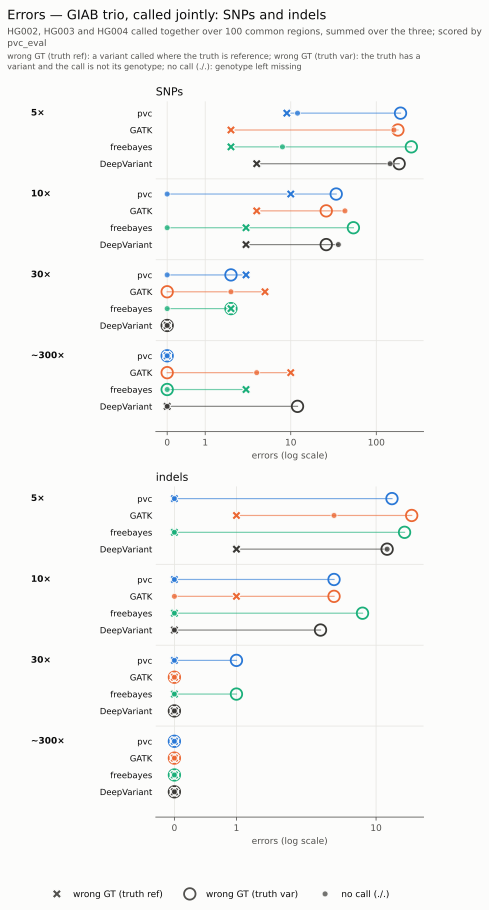
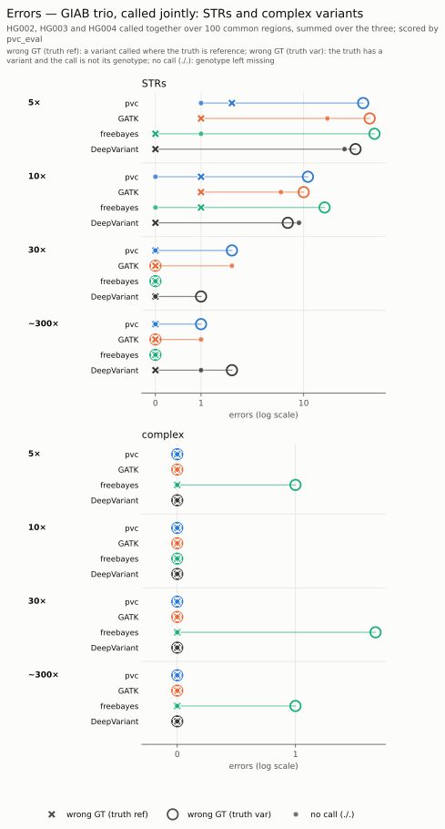
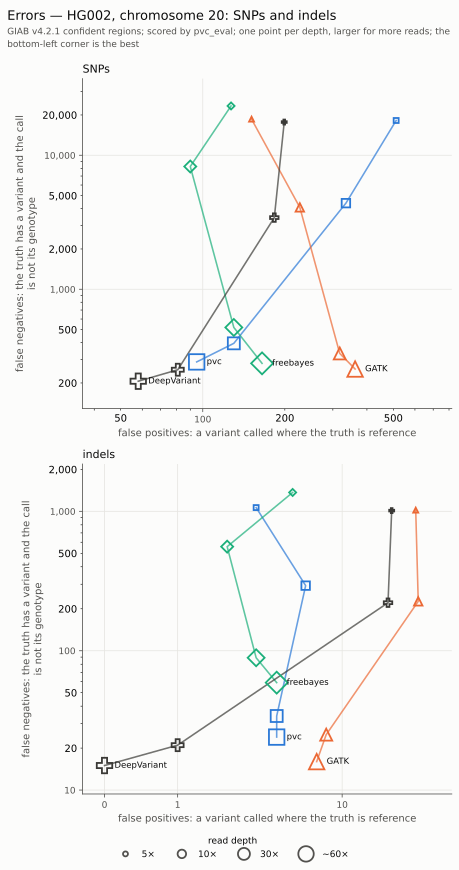
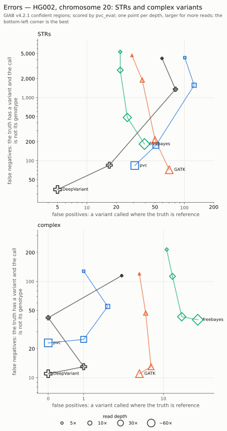

# Accuracy

Accuray comparison of pvc, GATK, freebayes, DeepVariant.

All the results on this page were measured on : pvc fedb2290, GATK 4.6.0.0, freebayes 1.3.6,
DeepVariant 1.10.0 (each sample called alone, then merged with GLnexus 1.4.1 where there are
several), HipSTR 0.6.2. pvc ran its full pipeline: pileup files, then parameters estimated from
the data, then calling.

The reads come from the Genome in a Bottle (GIAB) consortium's samples, downsampled at random
from the full data to each lower depth. Each depth is a separate run.

## Genotype counts

The figures show counts for three kinds of genotyping mistakes:

| mark | kind of mistake |
|---|---|
| ✕ | **a variant called where the truth is reference**: a false positive |
| ○ | **the truth has a variant and the call does not give its genotype**: a missed variant, or a heterozygote called homozygous, or the wrong alternative allele |
| • | **no genotype**: the caller left the sample's genotype missing (`./.`) |

The panels split the variants by what they are in the truth set and the call: SNPs, indels, STRs
(a change in the number of copies of a repeat unit), and complex variants (several changes
written as one record). A variant counted as complex for one caller may be an SNP or an indel
for another: freebayes writes variants a few bases apart as one record, so most of its
complex counts are SNPs and indels the other callers write separately.

## The GIAB trio

The child HG002 and the parents HG003 and HG004, called together over 100 regions (452 kb) where
the truth sets of all three are confident. Counts are summed over the three samples.

**Mendelian errors.** In a trio, a child's genotype must be possible given the parents': a child
`1/1` cannot have a `0/0` parent. A genotype that breaks this rule is a mistake in at least one of
the three, whichever the truth is, so the count needs no truth set. Among the sites where all
three samples have a genotype, the record passes the caller's filters, and at least one sample
carries a variant:

SNPs:

| depth | pvc | GATK | freebayes | DeepVariant |
|---|---|---|---|---|
| 5× | 68 of 579 | 58 of 428 | 62 of 510 | 61 of 445 |
| 10× | 13 of 651 | 9 of 610 | 10 of 604 | 9 of 621 |
| 30× | 1 of 656 | 0 of 668 | 0 of 626 | 0 of 667 |
| ~300× | 0 of 627 | 0 of 671 | 0 of 640 | 5 of 661 |

Indels:

| depth | pvc | GATK | freebayes | DeepVariant |
|---|---|---|---|---|
| 5× | 14 of 75 | 18 of 60 | 11 of 65 | 9 of 47 |
| 10× | 5 of 82 | 7 of 74 | 4 of 79 | 4 of 69 |
| 30× | 1 of 87 | 1 of 78 | 1 of 102 | 1 of 79 |
| ~300× | 1 of 116 | 1 of 79 | 1 of 92 | 1 of 78 |

The GIAB truth sets themselves have 0 errors among 667 SNP sites and 1 among 79 indel sites over
these regions. At 5× the share of SNP sites with an error is about the same for the four callers,
one in seven to one in nine; pvc checks more sites (579, against 428 to 510), because it leaves
fewer genotypes missing. For indels at 5×, GATK has an error at one site in three, the other
three callers at about one in five.

## Repeats: the GIAB tandem-repeat benchmark

HG002 alone, over the 50,000 regions (6.1 Mb) of GIAB's tandem-repeat benchmark v1.0.1. pvc
calls the STR loci with a dedicated STR model rather than the generic model used for SNPs and
short indels.

At each depth, how many of the 6,995 repeats where the truth carries a variant each caller
genotypes right, compared as repeat lengths:

| depth | pvc | DeepVariant | GATK | HipSTR |
|---|---|---|---|---|
| 5× | 46% | 45% | 39% | 15% |
| 10× | 70% | 69% | 62% | 46% |
| 15× | 80% | 79% | 72% | 61% |
| 20× | 84% | 83% | 77% | 67% |
| 30× | 88% | 87% | 82% | 73% |
| 50× | 89% | 89% | 86% | 76% |
| ~300× | 90% | 91% | 91% | 77% |

freebayes was not run on this benchmark.

## SNPs and indels across a chromosome: HG002, chromosome 20

HG002 over the whole of chromosome 20 (64 Mb), scored against GIAB's v4.2.1 truth set in
its confident regions.

The figures represent false
positives across (a variant called where the truth is reference) and false negatives down (the truth
has a variant and the call does not give its genotype). Each line is one caller, one point per
depth; the more reads, the larger the point. The nearer a point is to the bottom-left corner, the
fewer the mistakes.

## Simulated STRs: stutter with an exact truth

Real data cannot say how a caller copes with stutter, because neither the true genotypes at
every repeat nor the stutter rates are known. Here both are. A 4 Mb genome is drawn with 3,000
STRs, 500 for each motif length from 1 to 6 bases, and reads are drawn from it through a stutter
model, then mapped with minimap2. The simulation is run twice: once with PCR stutter, where a
read often gains or loses a repeat unit, and once with the much lower stutter of a PCR-free
library. Each is called with 1 sample and with 50, at 5×, 15×, 30× and 60×.

The unit counted is one sample at one STR. Per sample, 1,202 of the 3,000 STRs carry a variant
in the truth and 1,798 are reference. Each cell gives two numbers:

- the share of the variant genotypes called **right**: both of the sample's sequences over the
  STR, and 30 bases either side, are the truth's;
- the **false calls** per 1,000 reference genotypes: a variant called where the sample has none.

pvc estimated its parameters, stutter included, from the run's own reads. freebayes is kept at
QUAL ≥ 20. HipSTR ran at its defaults.

**PCR stutter.** Share right, then false calls per 1,000:

| samples | depth | pvc | GATK | freebayes | HipSTR |
|---|---|---|---|---|---|
| 1 | 5× | 42% · 4 | 45% · 28 | 28% · 13 | nothing called |
| 1 | 15× | 86% · 4 | 84% · 112 | 64% · 41 | nothing called |
| 1 | 30× | 96% · 2 | 92% · 174 | 84% · 79 | nothing called |
| 1 | 60× | 99% · 1 | 93% · 219 | 93% · 128 | nothing called |
| 50 | 5× | 72% · 22 | 45% · 25 | 56% · 88 | 62% · 63 |
| 50 | 15× | 95% · 10 | 88% · 92 | 88% · 132 | 89% · 30 |
| 50 | 30× | 99% · 7 | 94% · 119 | 95% · 124 | 93% · 16 |
| 50 | 60× | 100% · 6 | 96% · 125 | 97% · 121 | 94% · 11 |

**PCR-free.** Share right, then false calls per 1,000:

| samples | depth | pvc | GATK | freebayes | HipSTR |
|---|---|---|---|---|---|
| 1 | 5× | 45% · 3 | 44% · 3 | 27% · 2 | nothing called |
| 1 | 15× | 90% · 3 | 90% · 3 | 67% · 1 | nothing called |
| 1 | 30× | 98% · 0 | 99% · 4 | 89% · 1 | nothing called |
| 1 | 60× | 100% · 0 | 100% · 2 | 97% · 1 | nothing called |
| 50 | 5× | 75% · 11 | 48% · 2 | 59% · 12 | 66% · 22 |
| 50 | 15× | 97% · 2 | 92% · 6 | 92% · 15 | 92% · 5 |
| 50 | 30× | 100% · 0 | 98% · 4 | 97% · 7 | 94% · 1 |
| 50 | 60× | 100% · 0 | 99% · 2 | 99% · 3 | 94% · 0 |

- **With PCR stutter, the callers without a stutter model call stutter as variants.** At 30× in
  50 samples, GATK and freebayes call a variant at about 120 of every 1,000 reference genotypes,
  pvc at 7 and HipSTR at 16. More reads do not help them: GATK's false calls rise with depth,
  in one sample from 28 per 1,000 at 5× to 219 at 60×. They are worst in homopolymers, where
  stutter is highest: at 30× in 50 samples GATK calls a variant at 371 of every 1,000 reference
  homopolymer genotypes and at 67 for longer motifs; pvc at 25 and 3.
- **Without PCR stutter, every caller makes few false calls**, at most 22 per 1,000. The
  differences are in the share right, and largest at 5× in 50 samples: pvc 75%, HipSTR 66%,
  freebayes 59% and GATK 48%. GATK leaves about
  one genotype in eight missing there (7,520 of 61,458).
- **HipSTR calls nothing in one sample at its defaults.** It needs about 100 reads at a repeat
  before it calls it. Given a fixed stutter model and no read floor, it reaches 91% right at 60×
  with PCR stutter, with 139 false calls per 1,000.
- **pvc's stutter estimated from the reads is as good as the true one.** Given the simulator's
  own stutter rates instead, pvc gets the same share right to within 3 points in every row.

## Simulated inbreeding: does a wrong F cost genotypes?

A caller that assumes every sample is outbred expects heterozygotes in proportions an inbred
sample does not have. At low depth, where a heterozygote and a homozygote can look alike, that
expectation decides many genotypes. pvc estimates each sample's inbreeding coefficient F from
the data and uses it as the genotype prior; GATK and DeepVariant take no F.

The test is a simulated tomato population: 50 samples over 5 Mb of chromosome 1, 10 samples at
each of F = 0, 0.25, 0.5, 0.75 and 1, all called together. Every group has the same SNPs, one
per kilobase, at the same allele frequencies, so F is the only difference between the groups.
Reads are 150 bp PCR-free pairs simulated at 30×, then downsampled to each lower depth. Every
sample has about 5,000 SNP genotypes, about 250,000 in all.

pvc ran three ways:

- **F estimated**, its full pipeline;
- **F = 0**, its defaults, which take every sample as outbred;
- **F = 0.9 stated** for every sample, the opposite mistake for the outbred groups.

The 30× rows come from pvc c3d1ed69, as the run with fedb2290 has not reached that depth yet.
At the depths both versions ran, their results differ by less than a tenth of a point.

**pvc's estimate of F.** The mean of the 10 estimates in each group, with the lowest and highest,
against the F the simulation actually produced:

| simulated F | true F | 3× | 10× | 30× |
|---|---|---|---|---|
| 0 | 0.005 | 0.007 (0 to 0.06) | 0.009 (0 to 0.04) | 0.010 (0 to 0.04) |
| 0.25 | 0.252 | 0.237 (0.21 to 0.28) | 0.243 (0.21 to 0.27) | 0.241 (0.20 to 0.28) |
| 0.5 | 0.500 | 0.497 (0.44 to 0.56) | 0.501 (0.46 to 0.53) | 0.499 (0.46 to 0.53) |
| 0.75 | 0.751 | 0.759 (0.73 to 0.79) | 0.753 (0.73 to 0.79) | 0.752 (0.73 to 0.79) |
| 1 | 1.000 | 1.000 (1.00 to 1.00) | 1.000 (1.00 to 1.00) | 1.000 (1.00 to 1.00) |

**Non-reference genotypes right**, over all 50 samples: the genotypes right among those that
carry an alternative allele in the truth or in the call.

| depth | pvc, F estimated | pvc, F = 0 | pvc, F = 0.9 stated | GATK | DeepVariant |
|---|---|---|---|---|---|
| 3× | 84.3% | 79.0% | 82.7% | 64.6% | 65.0% |
| 5× | 93.8% | 91.5% | 93.2% | 85.2% | 85.5% |
| 10× | 98.6% | 98.4% | 98.5% | 97.6% | 97.1% |
| 15× | 99.3% | 99.3% | 99.3% | 99.4% | 98.9% |
| 30× | 99.5% | 99.5% | 99.5% | 99.7% | 99.8% |

**Homozygotes called heterozygous at 3×**, in each group of 10 samples (about 50,000 genotypes a
group):

| simulated F | pvc, F estimated | pvc, F = 0 | GATK | DeepVariant |
|---|---|---|---|---|
| 0 | 1,122 | 1,152 | 9 | 120 |
| 0.25 | 513 | 1,900 | 7 | 226 |
| 0.5 | 39 | 2,589 | 12 | 279 |
| 0.75 | 36 | 3,295 | 15 | 365 |
| 1 | 1 | 4,103 | 15 | 458 |

- **pvc estimates F well even at 3 reads a position.** Each group's mean is within 0.015 of
  the true F at every depth, and every sample's estimate is within about 0.06 of its group's.
- **Assuming the samples are outbred costs pvc genotypes in the inbred ones.** At 3×, with F = 0
  pvc calls 4,103 homozygotes heterozygous in the fully inbred group; with F estimated, 1. The
  cost falls with depth: at 15× it is 30 against 0.
- **Stating a wrong F costs much less than ignoring it.** With F = 0.9 stated for every sample,
  pvc calls 55% of the outbred group's heterozygotes right at 3×, against 70% with F estimated.
  Over all samples it still gets more right than with F = 0 (82.7% against 79.0%).
- **GATK and DeepVariant call few homozygotes heterozygous at 3×, but leave many genotypes
  missing.** At 3× GATK leaves 17,955 of the 45,056 heterozygotes without a genotype and
  DeepVariant 15,117; pvc leaves 2,261. Most of the gap at 3× and 5× is these missing genotypes.
  At 30× GATK and DeepVariant are slightly ahead of pvc, 99.7% and 99.8% against 99.5%.
