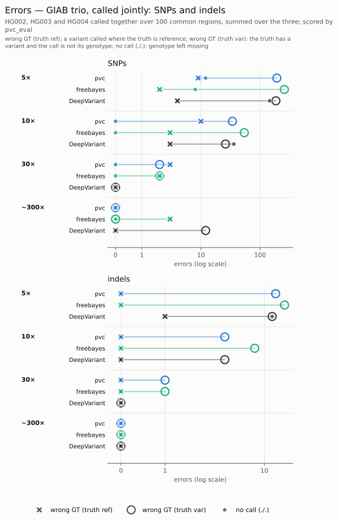
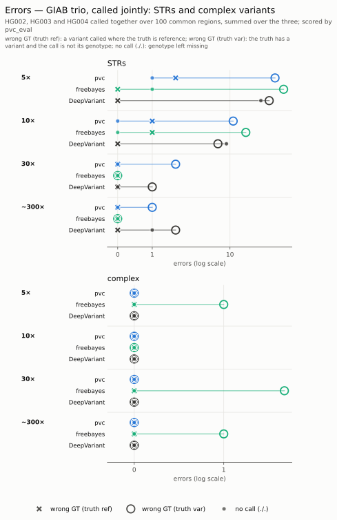
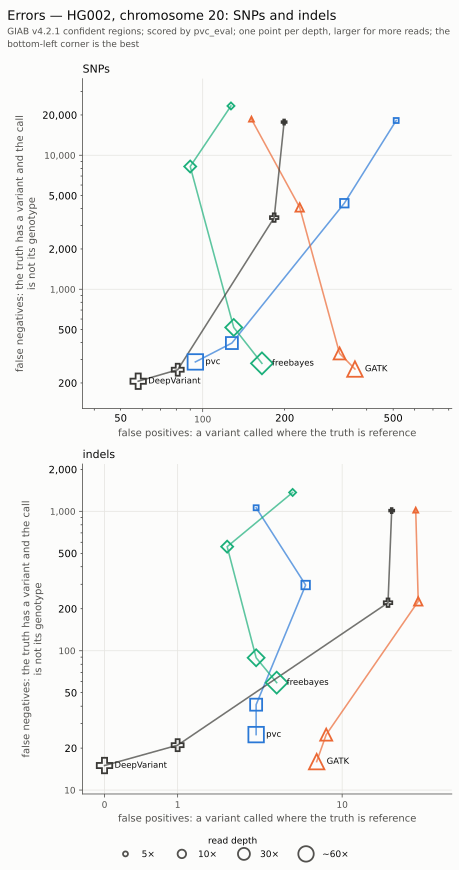
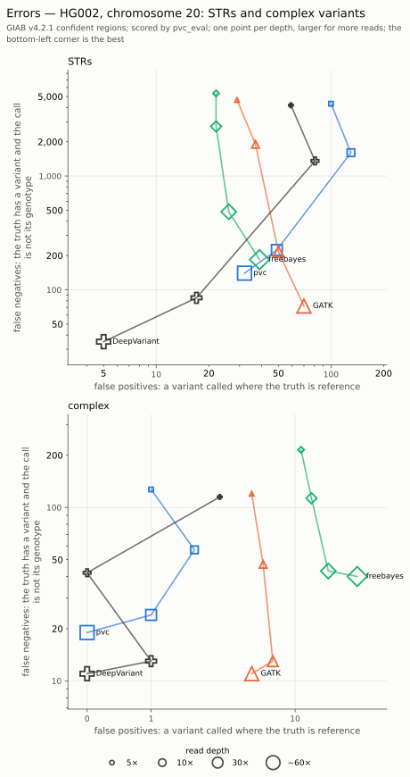

# Accuracy

Accuray comparison of pvc, GATK, freebayes, DeepVariant.

All the results on this page were measured on : pvc c3d1ed69, GATK 4.6.0.0, freebayes 1.3.6,
DeepVariant 1.10.0 (each sample called alone, then merged with GLnexus 1.4.1 where there are
several), HipSTR 0.6.2. pvc ran its full pipeline: pileup files, then parameters estimated from
the data, then calling.

The reads come from the Genome in a Bottle (GIAB) consortium's samples, downsampled at random
from the full data to each lower depth. Each depth is a separate run.

## Genotype counts

The figures show counts for three kinds of genotyping mistakes:

| mark | kind of mistake |
|---|---|
| ✕ | **a variant called where the truth is reference**: a false positive |
| ○ | **the truth has a variant and the call does not give its genotype**: a missed variant, or a heterozygote called homozygous, or the wrong alternative allele |
| • | **no genotype**: the caller left the sample's genotype missing (`./.`) |

The panels split the variants by what they are in the truth set and the call: SNPs, indels, STRs
(a change in the number of copies of a repeat unit), and complex variants (several changes
written as one record). A variant counted as complex for one caller may be an SNP or an indel
for another: freebayes writes variants a few bases apart as one record, so most of its
complex counts are SNPs and indels the other callers write separately.

## The GIAB trio

The child HG002 and the parents HG003 and HG004, called together over 100 regions (452 kb) where
the truth sets of all three are confident. Counts are summed over the three samples.

**Mendelian errors.** In a trio, a child's genotype must be possible given the parents': a child
`1/1` cannot have a `0/0` parent. A genotype that breaks this rule is a mistake in at least one of
the three, whichever the truth is, so the count needs no truth set. Among the sites where all
three samples have a genotype, the record passes the caller's filters, and at least one sample
carries a variant:

| depth | pvc SNPs | freebayes SNPs | DeepVariant SNPs | pvc indels | freebayes indels | DeepVariant indels |
|---|---|---|---|---|---|---|
| 5× | 68 of 580 | 62 of 510 | 61 of 445 | 14 of 75 | 11 of 65 | 9 of 47 |
| 10× | 13 of 652 | 10 of 604 | 9 of 621 | 5 of 82 | 4 of 79 | 4 of 69 |
| 30× | 1 of 656 | 0 of 626 | 0 of 667 | 1 of 87 | 1 of 102 | 1 of 79 |
| ~300× | 0 of 626 | 0 of 640 | 5 of 661 | 1 of 117 | 1 of 92 | 1 of 78 |

The GIAB truth sets themselves have 0 errors among 667 SNP sites and 1 among 79 indel sites over
these regions. At 5× the share of sites with an error is about the same for the three callers,
one in seven to one in nine; pvc checks more sites, because it leaves fewer genotypes missing.

## Repeats: the GIAB tandem-repeat benchmark

HG002 alone, over the 50,000 regions (6.1 Mb) of GIAB's tandem-repeat benchmark v1.0.1. pvc
calls the STR loci with a dedicated STR model rather than the generic model used for SNPs and
short indels.

At each depth, how many of the 6,995 repeats where the truth carries a variant each caller
genotypes right, compared as repeat lengths:

| depth | pvc | DeepVariant | GATK | HipSTR |
|---|---|---|---|---|
| 5× | 46% | 45% | 39% | 15% |
| 10× | 71% | 69% | 62% | 46% |
| 15× | 80% | 79% | 72% | 61% |
| 20× | 85% | 83% | 77% | 67% |
| 30× | 88% | 87% | 82% | 73% |
| 50× | 90% | 89% | 86% | 76% |
| ~300× | 91% | 91% | 91% | 77% |

freebayes was not run on this benchmark.

## SNPs and indels across a chromosome: HG002, chromosome 20

HG002 over the whole of chromosome 20 (64 Mb), scored against GIAB's v4.2.1 truth set in
its confident regions.

The figures represent false
positives across (a variant called where the truth is reference) and false negatives down (the truth
has a variant and the call does not give its genotype). Each line is one caller, one point per
depth; the more reads, the larger the point. The nearer a point is to the bottom-left corner, the
fewer the mistakes.

