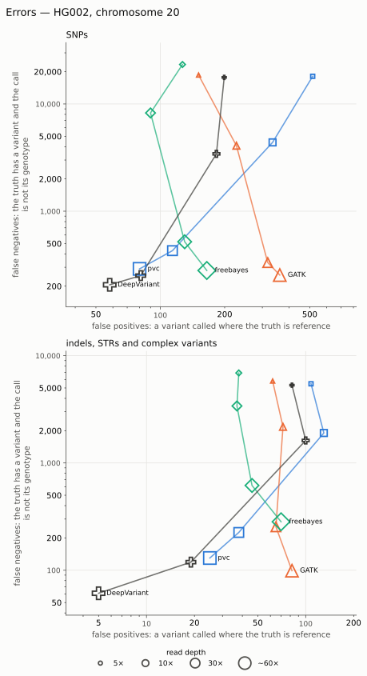
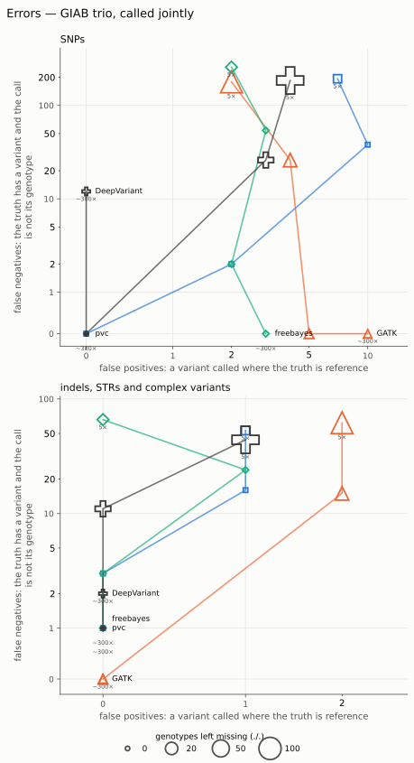
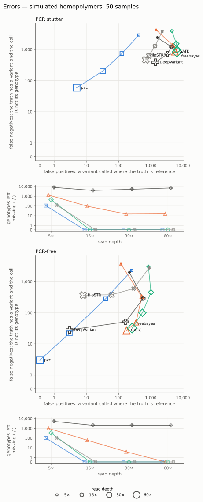
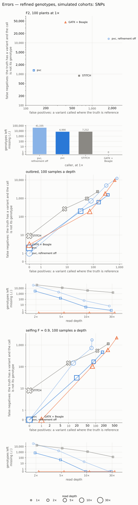
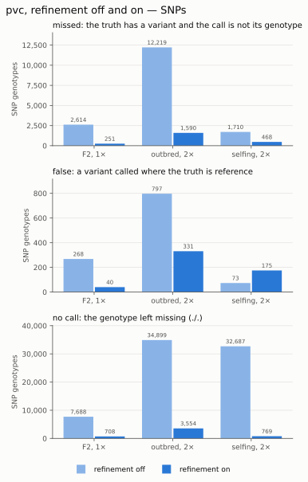
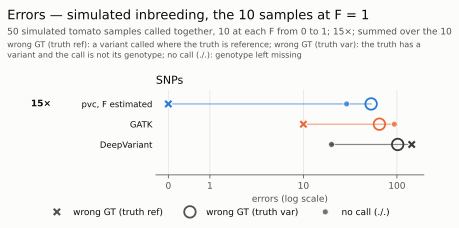
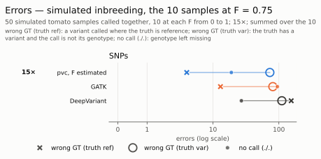
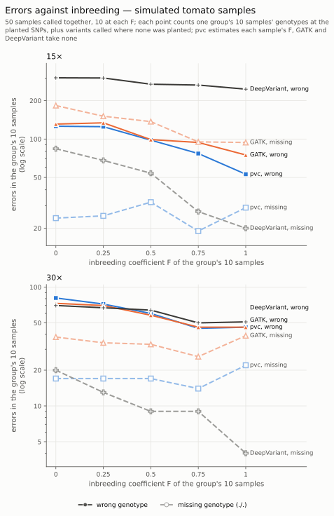

# Accuracy

pvc's accuracy has been compared with that of other tools on:

- real human data from Genome in a Bottle (GIAB), and on
- simulations.

The real reads are GIAB's, downsampled at random from the full data to each lower depth; each
depth is a separate run.

The tools used in the comparison were:

- GATK 4.6.0.0, HaplotypeCaller and joint genotyping;
- freebayes 1.3.6;
- DeepVariant 1.10.0;
- GLnexus 1.4.1;
- HipSTR 0.6.2;
- Beagle 4.1 and STITCH 1.8.5.

## HG002, chromosome 20

GIAB sample HG002 over the whole of chromosome 20, scored against GIAB's v4.2.1 truth set in
its confident regions. pvc version eb5a9367.

*Each line corresponds to one caller, from 5× to about 60×: one point per depth. The bottom-left corner is the best.*

Number of false variants (a
variant called where the truth is reference) and the missed variants (the truth has a variant
and the call does not give its genotype).

**SNPs**, of about 63,700 true SNPs:

| depth | pvc | GATK | freebayes | DeepVariant |
|---|---|---|---|---|
| 5× | 516 · 18,117 | 151 · 18,601 | 127 · 23,346 | 199 · 17,698 |
| 10× | 335 · 4,383 | 227 · 4,083 | 90 · 8,247 | 183 · 3,427 |
| 30× | 114 · 429 | 318 · 332 | 130 · 519 | 81 · 251 |
| ~60× | 80 · 290 | 362 · 254 | 165 · 280 | 58 · 206 |

DeepVariant makes the fewest mistakes at 30× and 60×, and pvc the next fewest. At 5× pvc calls
the most false SNPs.

**Other variants**: indels, STRs and complex variants together, of about 14,800 true variants
(about 15,500 for freebayes, which writes nearby SNPs and indels as one complex record):

| depth | pvc | GATK | freebayes | DeepVariant |
|---|---|---|---|---|
| 5× | 108 · 5,470 | 62 · 5,798 | 38 · 6,902 | 82 · 5,311 |
| 10× | 130 · 1,903 | 72 · 2,172 | 37 · 3,398 | 100 · 1,621 |
| 30× | 38 · 225 | 65 · 254 | 46 · 617 | 19 · 119 |
| ~60× | 25 · 130 | 82 · 99 | 70 · 283 | 5 · 61 |

DeepVariant makes the fewest mistakes at 30× and 60×, and pvc the next fewest. At 5× and 10× pvc
calls the most false variants.

## The GIAB trio

The child HG002 and the parents HG003 and HG004, called together over 100 regions (452 kb) where
the truth sets of all three are confident. Counts are summed over the three samples. pvc version
eb5a9367.

*Each line corresponds to one caller, joining its results from 5× to about 300×. The size of each
mark is the number of genotypes the caller left missing (`./.`); a missing genotype is counted
only there, not as a false positive or a false negative. The bottom-left corner is the best. The
axes are on a log scale.*

The first panel counts the SNPs; the second the indels, STRs (a change in the number of copies
of a repeat unit) and complex variants (several changes written as one record) together. A
variant counted as complex for one caller may be a SNP or an indel for another: freebayes writes
variants a few bases apart as one record, so some of its errors in the second panel are SNPs
and indels the other callers write separately.

At 5× and 10×, pvc gets about as many genotypes wrong as the other callers, and leaves almost
  none missing. At 5×, each caller gives the wrong genotype for between about 180 and 260 of
  the trio's true SNP genotypes. Besides those, GATK and DeepVariant leave about 150 missing, pvc
  about 12. The same holds for the other variants: at 5× each caller gets 44 to 66 wrong,
  and GATK and DeepVariant leave another 22 and 37 missing, pvc 1.

At 30× and above, every caller makes 12 errors or fewer of any kind.

**Mendelian errors.** In a trio, a child's genotype must be possible given the parents': a child
`1/1` cannot have a `0/0` parent. A genotype that breaks this rule is a mistake in at least one of
the three, whichever the truth is, so the count needs no truth set. 

SNPs:

| depth | pvc | GATK | freebayes | DeepVariant |
|---|---|---|---|---|
| 5× | 67 of 574 | 58 of 428 | 62 of 510 | 61 of 445 |
| 10× | 13 of 649 | 9 of 610 | 10 of 604 | 9 of 621 |
| 30× | 1 of 655 | 0 of 668 | 0 of 626 | 0 of 667 |
| ~300× | 0 of 627 | 0 of 671 | 0 of 640 | 5 of 661 |

Indels:

| depth | pvc | GATK | freebayes | DeepVariant |
|---|---|---|---|---|
| 5× | 13 of 75 | 18 of 60 | 11 of 65 | 9 of 47 |
| 10× | 5 of 83 | 7 of 74 | 4 of 79 | 4 of 69 |
| 30× | 2 of 87 | 1 of 78 | 1 of 102 | 1 of 79 |
| ~300× | 1 of 115 | 1 of 79 | 1 of 92 | 1 of 78 |

At 5× the share of SNP sites with an error is about the same for the four callers,
one in seven to one in nine. For indels at 5×, GATK has an error at one site in three, the other
three callers at about one in five.

## STRs

### Simulated STRs

The simulation is based on a 4 Mb genomic region with 3,000
STRs, 500 for each motif length from 1 to 6 bases, and reads are drawn from it through a stutter
model, then mapped with minimap2. The simulation is run twice: once with PCR stutter, where a
read often gains or loses a repeat unit, and once with the much lower stutter of a PCR-free
library. Each is called with 1 sample and with 50, at 5×, 15×, 30× and 60×.

pvc version eb5a9367 estimated its parameters, stutter included, from the run's own reads. freebayes is kept at
QUAL ≥ 20. HipSTR ran at its defaults.

*Homopolymers in 50 samples, with and without PCR stutter. Each line is one caller, joining its
results from 5× to 60×. The size of each mark is the number of genotypes the caller left missing
(`./.`); a missing genotype is counted only there, not as a false positive or a false negative.
False positives are counted among the 15,275 reference genotypes, false negatives among the 9,725
variant genotypes. The bottom-left corner is the best. Both panels have the same log scales. pvc
version eb5a9367.*

DeepVariant's missing genotypes are mostly at homopolymers where the truth is reference: in the
PCR-free library at 30×, 1,947 of its 2,030. It leaves a genotype missing (`NoCall`) at long
homopolymers where some of the reads are one base shorter, and more reads do not change that.

**PCR stutter.** Share right, then false calls per 1,000:

| samples | depth | pvc | GATK | freebayes | DeepVariant | HipSTR |
|---|---|---|---|---|---|---|
| 1 | 5× | 42% · 4 | 45% · 28 | 28% · 13 | 40% · 37 | nothing called |
| 1 | 15× | 86% · 4 | 84% · 112 | 64% · 41 | 80% · 115 | nothing called |
| 1 | 30× | 96% · 2 | 92% · 174 | 84% · 79 | 89% · 100 | nothing called |
| 1 | 60× | 99% · 1 | 93% · 219 | 93% · 128 | 88% · 21 | nothing called |
| 50 | 5× | 72% · 18 | 45% · 25 | 56% · 88 | 40% · 28 | 62% · 63 |
| 50 | 15× | 95% · 5 | 88% · 92 | 88% · 132 | 85% · 94 | 89% · 30 |
| 50 | 30× | 99% · 1 | 94% · 119 | 95% · 124 | 94% · 80 | 93% · 16 |
| 50 | 60× | 100% · 0 | 96% · 125 | 97% · 121 | 96% · 28 | 94% · 11 |

**PCR-free.** Share right, then false calls per 1,000:

| samples | depth | pvc | GATK | freebayes | DeepVariant | HipSTR |
|---|---|---|---|---|---|---|
| 1 | 5× | 45% · 3 | 44% · 3 | 27% · 2 | 41% · 5 | nothing called |
| 1 | 15× | 90% · 3 | 90% · 3 | 67% · 1 | 89% · 9 | nothing called |
| 1 | 30× | 98% · 0 | 99% · 4 | 89% · 1 | 98% · 3 | nothing called |
| 1 | 60× | 100% · 0 | 100% · 2 | 97% · 1 | 96% · 0 | nothing called |
| 50 | 5× | 75% · 10 | 48% · 2 | 59% · 12 | 43% · 3 | 66% · 22 |
| 50 | 15× | 97% · 1 | 92% · 6 | 92% · 15 | 90% · 7 | 92% · 5 |
| 50 | 30× | 100% · 0 | 98% · 4 | 97% · 7 | 98% · 2 | 94% · 1 |
| 50 | 60× | 100% · 0 | 99% · 2 | 99% · 3 | 98% · 0 | 94% · 0 |

The counts in these tables correspond one STR in one sample. Each cell gives two numbers:

- the share of the variant genotypes called **right**: both of the sample's sequences over the
  STR, and 30 bases either side, are the truth's;
- the **false calls** per 1,000 reference genotypes: a variant called where the sample has none.

With PCR stutter, the callers without a stutter model tend to call stutter as variants. At 30× in
  50 samples, GATK and freebayes call a variant at about 120 of every 1,000 reference genotypes,
  DeepVariant at 80, HipSTR at 16 and pvc at 1. More reads do not help them: GATK's false calls rise with depth,
  in one sample from 28 per 1,000 at 5× to 219 at 60×.

Without PCR stutter, every caller makes few false calls, at most 22 per 1,000.

### GIAB STRs

HG002 sample over the 50,000 regions (6.1 Mb) of GIAB's tandem-repeat benchmark v1.0.1. pvc version eb5a9367.

At each depth, how many of the 6,995 repeats where the truth carries a variant each caller
genotypes right, compared as repeat lengths:

| depth | pvc | DeepVariant | GATK | HipSTR |
|---|---|---|---|---|
| 5× | 46% | 45% | 39% | 15% |
| 10× | 70% | 69% | 62% | 46% |
| 15× | 80% | 79% | 72% | 61% |
| 20× | 85% | 83% | 77% | 67% |
| 30× | 88% | 87% | 82% | 73% |
| 50× | 90% | 89% | 86% | 76% |
| ~300× | 90% | 91% | 91% | 77% |

freebayes was not run on this benchmark.

### HG002, chromosome 20

The STRs of the chromosome 20 benchmark above: false variants · missed variants, of about
11,150 true STR variants:

| depth | pvc | GATK | freebayes | DeepVariant |
|---|---|---|---|---|
| 5× | 104 · 4,282 | 29 · 4,658 | 22 · 5,321 | 59 · 4,184 |
| 10× | 123 · 1,557 | 37 · 1,899 | 22 · 2,727 | 81 · 1,358 |
| 30× | 33 · 166 | 50 · 216 | 26 · 485 | 17 · 85 |
| ~60× | 21 · 83 | 70 · 72 | 39 · 184 | 5 · 35 |

pvc calls the most false STR variants at 5× and 10×. DeepVariant makes the fewest mistakes at
30× and 60×.

At 5× and 10× most of the missed STR variants are heterozygotes: few reads cross the STR, so
often only one of the two alleles is seen. Of the 11,150 true STR variants, about 7,300 are
heterozygous and 3,900 homozygous. At 5× every caller misses about half of the heterozygotes
(49% to 65%), but only 14% to 17% of the homozygotes, and 85% to 88% of each caller's missed
STR variants are heterozygotes. Most of these are called homozygous for the reference allele.
At 10× the callers miss 17% to 34% of the heterozygotes and 4% to 7% of the homozygotes.

## Imputation: genotype refinement and filling

pvc can take into account the other samples' haplotypes at the surrounding loci, as priors, to refine each sample's genotypes or to fill missing data: it works out which samples' haplotypes the sample's two copies resemble
along the genome, and calls the sample from its own reads together with theirs. Where the sample
has no read at all, this fills a genotype the reads alone could not give. This approach is similar to that of Beagle and STITCH.

Three cohorts are simulated over one 4 Mb genome, with reads mapped by minimap2:

- **an F2**: two inbred parents at 30× and 20 F2 plants at 1×, with one crossover a contig in each
  meiosis, so crossovers are about 80 times denser than on a real tomato chromosome;
- **an outbred population** of 400 samples, drawn with a coalescent simulation (msprime), 100
  samples each at 30×, 10×, 5× and 2×;
- **a selfing population**, the same design with the samples selfed to F = 0.9.

The tools:

- **pvc** eb5a9367, with refinement forced on (`--refine-genotypes on`);
- **GATK** 4.6.0.0, joint calling, as elsewhere on this page;
- **GATK + Beagle**: Beagle 4.1 (27Jan18.7e1) run on GATK's calls, first to call genotypes from
  GATK's genotype likelihoods, then to phase them;
- **STITCH** 1.8.5, which calls genotypes from the reads at GATK's SNP sites.

Beagle and STITCH were given the simulation's true recombination rate and, in the two
populations, its true effective size. STITCH calls only SNPs, so the tables count SNPs only.

*SNPs only, because STITCH calls only SNPs; genotypes with and without reads summed. GATK alone,
which fills no genotype, is in the tables below; pvc with the refinement off is the paler blue
line. In the F2
each caller is one point, its 20 plants at 1×. In the two populations each line is one caller,
joining its groups of 100 samples from 2× to 30×. The size of each mark is the number of
genotypes the caller left missing (`./.`); a missing genotype is counted only there, not as a
false positive or a false negative. The bottom-left corner is the best. The axes are on a log
scale. pvc version eb5a9367.*

Each table cell gives three counts of one sample's genotype at one SNP, in this order:

- **missed**: the truth has a variant and the call does not give its genotype;
- **false**: a variant called where the truth is reference;
- **no call**: the genotype left missing (`./.`).

Genotypes are split by whether the sample had any mapped read over the SNP. In the 30× groups
every tool makes at most 9 errors of the first two kinds, so those rows are left out.

**F2**, the 20 plants at 1× (7,107 true heterozygous genotypes):

| reads | pvc | GATK | GATK + Beagle | STITCH |
|---|---|---|---|---|
| with reads | 187 · 32 · 1 | 1,902 · 40 · 6,021 | 4,144 · 149 · 0 | 471 · 385 · 1,235 |
| without reads | 40 · 7 · 734 | 0 · 0 · 7,895 | 2,850 · 177 · 0 | 293 · 235 · 930 |

**Outbred population**, 100 samples a group (about 36,500 true heterozygous genotypes a group):

| depth | reads | pvc | GATK | GATK + Beagle | STITCH |
|---|---|---|---|---|---|
| 10× | with reads | 193 · 39 · 0 | 722 · 65 · 3,360 | 190 · 73 · 0 | 265 · 8 · 3,906 |
| 5× | with reads | 624 · 146 · 1 | 5,488 · 209 · 11,144 | 1,786 · 278 · 0 | 946 · 56 · 11,522 |
| 5× | without reads | 7 · 1 · 165 | 1 · 0 · 2,297 | 47 · 6 · 0 | 21 · 1 · 475 |
| 2× | with reads | 1,413 · 333 · 7 | 11,874 · 142 · 24,547 | 7,917 · 498 · 0 | 1,878 · 123 · 28,997 |
| 2× | without reads | 114 · 5 · 3,494 | 18 · 0 · 41,191 | 1,723 · 163 · 0 | 453 · 23 · 10,889 |

**Selfing population, F = 0.9**, 100 samples a group (about 3,500 true heterozygous genotypes a
group):

| depth | reads | pvc | GATK | GATK + Beagle | STITCH |
|---|---|---|---|---|---|
| 10× | with reads | 28 · 19 · 0 | 159 · 59 · 2,057 | 107 · 75 · 0 | 147 · 10 · 1,225 |
| 5× | with reads | 165 · 85 · 0 | 595 · 205 · 4,855 | 584 · 274 · 0 | 538 · 110 · 4,790 |
| 5× | without reads | 3 · 3 · 41 | 1 · 0 · 2,028 | 12 · 7 · 0 | 8 · 5 · 185 |
| 2× | with reads | 391 · 174 · 2 | 1,134 · 152 · 15,866 | 1,815 · 466 · 0 | 959 · 254 · 12,105 |
| 2× | without reads | 86 · 21 · 724 | 13 · 0 · 38,737 | 345 · 130 · 0 | 182 · 36 · 4,422 |

**pvc with the refinement off and on**, the same SNP genotypes, with and without reads summed;
each cell gives the count with the refinement off, then on:

| cohort, depth | missed | false | no call |
|---|---|---|---|
| F2, 1× | 2,614 → 227 | 268 → 39 | 7,688 → 735 |
| outbred, 2× | 12,219 → 1,527 | 797 → 338 | 34,899 → 3,501 |
| outbred, 5× | 5,006 → 631 | 313 → 147 | 1,972 → 166 |
| outbred, 10× | 727 → 196 | 82 → 39 | 59 → 4 |
| selfing, 2× | 1,710 → 477 | 73 → 195 | 32,687 → 726 |
| selfing, 5× | 730 → 168 | 70 → 88 | 1,727 → 41 |

At 30× the refinement changes no count by more than 4.

*The table's counts as bars, at each cohort's lowest depth: one panel per kind of error, each with
its own scale, starting at 0. The paler bar is the refinement off, the darker one on. For
reference, the counts are out of 20,420 SNP genotypes in the F2 (20 plants), 266,400 in the
outbred group and 245,200 in the selfing group (100 samples each).*

**Phase**, over all the samples of each cohort. A heterozygote is phased right when its two alleles
are written in the truth's order. A wrong link is a switch between two consecutive phased
heterozygotes of one sample: one copy's alleles cross over to the other. STITCH, as run here,
writes no phase, and GATK phases a few hundred heterozygotes at most.

| cohort | true heterozygotes | phased right, pvc | phased right, Beagle | wrong links, pvc | wrong links, Beagle |
|---|---|---|---|---|---|
| F2 | 7,107 | 5,718 | 1,891 | 5 of 5,409 | 527 of 1,816 |
| outbred | 145,951 | 121,602 | 135,247 | 9 of 95,171 | 5,443 of 133,654 |
| selfing | 14,206 | 10,989 | 13,667 | 3 of 9,497 | 236 of 13,006 |

- **With reads at 2× and 1×, pvc misses the fewest variants and leaves almost none uncalled.** In
  the outbred 2× group pvc misses 1,413 variant genotypes, STITCH 1,878, Beagle 7,917 and GATK
  11,874; pvc leaves 7 uncalled, against about 25,000 for GATK and 29,000 for STITCH. In the F2,
  pvc misses 187, STITCH 471 and Beagle 4,144.
- **Without reads, pvc fills most genotypes and gets few of them wrong; Beagle fills all of them
  and gets more wrong.** In the outbred 2× group pvc leaves 3,494 uncalled and gets 119 wrong,
  Beagle leaves none and gets 1,886 wrong, and STITCH leaves 10,889 and gets 476 wrong. GATK
  fills nothing.
- **In the outbred population pvc calls more false variants than STITCH, but fewer than
  Beagle.** With reads, pvc calls 333 false variants at 2×, 146 at 5× and 39 at 10×; STITCH 123,
  56 and 8; Beagle 498, 278 and 73. The refinement halves pvc's false variants: with it off, pvc
  calls 797, 313 and 82. In the selfing population pvc calls fewer than STITCH at 2× and 5×, 174
  and 85 against 254 and 110.
- **Beagle phases more heterozygotes; pvc's phase almost never switches.** In the outbred
  population Beagle phases 135,247 of the 145,951 heterozygotes right and pvc 121,602, but Beagle
  switches copies at about 4 links in 100 and pvc at about 1 in 10,000 (9 of 95,171). In the F2
  pvc phases 5,718 of the 7,107 heterozygotes right and Beagle 1,891, and Beagle switches at more
  than one link in four.

These results come from 22 and 400 samples at 1× to 30×. They do not show how the refinement
behaves in a cohort of a few samples.

## Simulated inbreeding: does a wrong F cost genotypes?

A caller that assumes every sample is outbred expects heterozygotes in proportions an inbred
sample does not have. At low depth, where a heterozygote and a homozygote can look alike, that
expectation decides many genotypes. pvc estimates each sample's inbreeding coefficient F from
the data and uses it as the genotype prior; GATK and DeepVariant take no F.

The test is a simulated tomato population: 50 samples over 5 Mb of chromosome 1, 10 samples at
each of F = 0, 0.25, 0.5, 0.75 and 1, all called together. Every group has the same SNPs, one
per kilobase, at the same allele frequencies, so F is the only difference between the groups.
Reads are 150 bp PCR-free pairs simulated at 30×, then downsampled to each lower depth. Every
sample has about 5,000 SNP genotypes, about 250,000 in all.

pvc ran three ways:

- **F estimated**, its full pipeline;
- **F = 0**, its defaults, which take every sample as outbred;
- **F = 0.9 stated** for every sample, the opposite mistake for the outbred groups.

pvc version eb5a9367.

**pvc's estimate of F.** The mean of the 10 estimates in each group, with the lowest and highest,
against the F the simulation actually produced:

| simulated F | true F | 3× | 10× | 30× |
|---|---|---|---|---|
| 0 | 0.005 | 0.007 (0 to 0.06) | 0.009 (0 to 0.04) | 0.010 (0 to 0.04) |
| 0.25 | 0.252 | 0.237 (0.21 to 0.28) | 0.242 (0.21 to 0.27) | 0.241 (0.20 to 0.28) |
| 0.5 | 0.500 | 0.496 (0.44 to 0.56) | 0.501 (0.46 to 0.53) | 0.499 (0.46 to 0.53) |
| 0.75 | 0.751 | 0.759 (0.73 to 0.79) | 0.753 (0.73 to 0.79) | 0.752 (0.73 to 0.79) |
| 1 | 1.000 | 1.000 (1.00 to 1.00) | 1.000 (1.00 to 1.00) | 1.000 (1.00 to 1.00) |

**Non-reference genotypes right**, over all 50 samples: the genotypes right among those that
carry an alternative allele in the truth or in the call.

| depth | pvc, F estimated | pvc, F = 0 | pvc, F = 0.9 stated | GATK | DeepVariant |
|---|---|---|---|---|---|
| 3× | 84.6% | 79.2% | 83.0% | 64.6% | 65.0% |
| 5× | 94.2% | 92.0% | 93.5% | 85.2% | 85.5% |
| 10× | 99.0% | 98.9% | 98.8% | 97.6% | 97.1% |
| 15× | 99.6% | 99.6% | 99.5% | 99.4% | 98.9% |
| 30× | 99.8% | 99.7% | 99.8% | 99.7% | 99.8% |

**Homozygotes called heterozygous at 3×**, in each group of 10 samples (about 50,000 genotypes a
group):

| simulated F | pvc, F estimated | pvc, F = 0 | GATK | DeepVariant |
|---|---|---|---|---|
| 0 | 1,127 | 1,159 | 9 | 120 |
| 0.25 | 513 | 1,902 | 7 | 226 |
| 0.5 | 40 | 2,599 | 12 | 279 |
| 0.75 | 36 | 3,306 | 15 | 365 |
| 1 | 1 | 4,122 | 15 | 458 |

**Errors at 15× in the two most inbred groups**: each row is one caller, pvc with F estimated,
and its marks count the 10 samples' genotypes of each kind of mistake:

| mark | kind of mistake |
|---|---|
| ✕ | **a variant called where the truth is reference**: a false positive |
| ○ | **the truth has a variant and the call does not give its genotype**: a missed variant, or a heterozygote called homozygous, or the wrong alternative allele |
| • | **no genotype**: the caller left the sample's genotype missing (`./.`) |

**Errors against F.** Every error in each group, summed over its 10 samples, split into
genotypes called wrong (a variant where the truth is reference, or a variant's genotype wrong)
and genotypes left missing. Each caller has a solid line for its wrong genotypes and a paler,
dashed one for its missing ones. If a caller's model ignored F at a cost, its lines would fall
more steeply with F than another's, or rise. Each depth has its own scale.

At lower depths the counts are larger, and pvc makes about half the errors of the other two or
fewer. Every error in the group's 10 samples, wrong and missing together:

| depth | F | pvc | GATK | DeepVariant |
|---|---|---|---|---|
| 3× | 0 | 8,168 | 16,637 | 15,186 |
| 3× | 1 | 2,613 | 6,871 | 5,583 |
| 5× | 0 | 3,048 | 7,652 | 7,156 |
| 5× | 1 | 461 | 1,744 | 1,589 |
| 10× | 0 | 461 | 1,282 | 1,363 |
| 10× | 1 | 100 | 347 | 535 |

- **pvc estimates F well even at 3 reads a position.** Each group's mean is within 0.015 of
  the true F at every depth, and every sample's estimate is within about 0.06 of its group's.
- **Assuming the samples are outbred costs pvc genotypes in the inbred ones.** At 3×, with F = 0
  pvc calls 4,122 homozygotes heterozygous in the fully inbred group; with F estimated, 1. The
  cost falls with depth: at 15× it is 30 against 0.
- **Stating a wrong F costs much less than ignoring it.** With F = 0.9 stated for every sample,
  pvc calls 55% of the outbred group's heterozygotes right at 3×, against 71% with F estimated.
  Over all samples it still gets more right than with F = 0 (83.0% against 79.2%).
- **GATK and DeepVariant call few homozygotes heterozygous at 3×, but leave many genotypes
  missing.** At 3× GATK leaves 17,955 of the 45,056 heterozygotes without a genotype and
  DeepVariant 15,117; pvc leaves 2,268. Most of the gap at 3× and 5× is these missing genotypes.
  At 30× pvc and DeepVariant get 99.8% right, GATK 99.7%.
- **At 15×, pvc makes the fewest errors in both groups.** Adding the three marks, at F = 1 pvc
  makes 82 errors, GATK 169 and DeepVariant 266; at F = 0.75, 96, 189 and 292. pvc also gets the
  fewest planted SNPs wrong (53 against 102 for DeepVariant at F = 1, 73 against 111 at
  F = 0.75), and DeepVariant calls a variant where nothing was planted 144 and 152 times; pvc
  never does.

