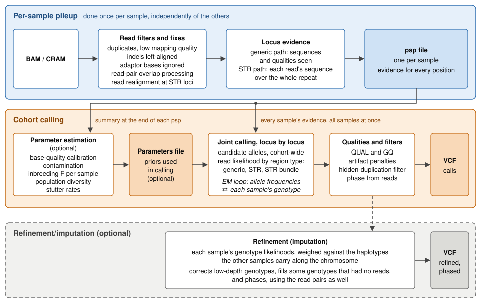

# Methods

This page explains how pvc gets from reads to genotypes, and why it does each step the way it
does. It is written for readers who know callers such as GATK and freebayes, and tools such as
Beagle and STITCH, and want to judge pvc's model. For how to run pvc, see
[Calling](calling.md); this page links to the usage pages instead of repeating them.

Where a number is a default, it is given as one.

## 1. Overview

pvc is a population caller. It calls SNPs, indels and short tandem repeats (STRs) in all the
samples of a cohort at once, and each sample's genotype is informed by what the other samples
carry.



*The blue lane is done once per sample and never again. The orange lane is done over the whole
cohort, and again when a sample is added. The grey lane is optional. In direct mode
(`call-from-alignments`) there is no psp file and no parameter estimation: the evidence goes
straight from the first lane to joint calling, with built-in parameter values or a parameters
file from an earlier run.*

The steps, in order:

1. **Per sample: gather the evidence.** The reads are filtered and corrected, and what they show
   at every locus is written to a per-sample pileup file (a *psp file*). No genotype is called
   and no likelihood is computed here (sections 2 and 3).
2. **Per cohort: estimate the parameters.** How often each library's bases are wrong, how inbred
   each sample is, how variable the population is, how often repeats stutter. All of it is
   estimated from the cohort's own reads, without calling a genotype first (sections 6 and 7).
3. **Per cohort: call.** The genome is divided into region types, each with its own model of
   how a read arises from an allele (section 4). At each locus the candidate alleles are chosen
   from all samples (section 5), and a loop alternates between the allele frequencies and the
   samples' genotypes until they agree (section 8). Qualities and site filters follow
   (sections 9 and 10).
4. **Optionally: refine.** Each sample's genotypes are called again using the haplotypes the
   other samples carry along the chromosome (section 11), and the genotypes are phased
   (section 12).

Two design choices explain most of the rest:

- **The evidence is stored per sample, and the model is applied per cohort.** GATK stores each
  sample's genotype likelihoods in a gVCF, computed before the cohort is known. freebayes keeps
  nothing it can call from later, and reads every alignment in every run. pvc stores the reads' evidence before
  any model touches it, so a new sample costs one new file, and the model applied later can use
  parameters and candidate alleles that come from the whole cohort.
- **Nothing is learned from a first rough set of calls.** Every parameter is estimated by
  summing over all the genotypes a sample could have, weighted by their probability, and never
  by choosing one. There are no known-variant files to supply and no hard-filtered training
  set.

## 2. Read filters and read fixes

### Filters

pvc ignores duplicates, QC failures, secondary, supplementary and unmapped reads, reads with a
mapping quality below 20, reads shorter than 30 bases, reads with a malformed alignment, and
reads where more than 1 aligned base in 10 disagrees with the reference.
[Preparing the inputs](inputs.md#read-filters) gives the exact rules. The filters have no
options.

On the generic path there is no minimum base quality. A poor base is kept and given the small
weight its quality implies. On the STR path, a read that spans a repeat is used as a complete
observation only if at least three quarters of its bases there have quality 15 or more.

### Fixes

A fix changes how a read is counted without discarding it. Each one removes a known way in
which reads give false evidence.

- **Indels are left-aligned.** One deletion inside a run of identical bases can be written at
  several positions, and mappers do not always choose the same one. On the generic path (the
  SNP and indel path, section 4), pvc moves every indel of every read to its leftmost
  equivalent position, so all the reads that carry one indel show it in one place.
- **Bases read past the end of the fragment are ignored.** When a DNA fragment is shorter than
  the read length, the sequencer reads through the fragment into the adaptor. pvc detects this
  from the pair: the two mates map to opposite strands of one chromosome, and the fragment
  length the mapper reports is shorter than the read. On the generic path, the bases beyond the
  fragment's end are not counted.
- **Overlapping mates count once.** Where the two mates of a pair cover the same position, they
  are two readings of one molecule, not two independent observations. If they show the same
  base, one mate keeps it with the sum of the two qualities (at most 200), and the other mate's
  bases there are given quality 0, so they carry no weight. If they disagree, the mate with the
  higher quality keeps its base at 0.8 of its Phred quality, and the other is given quality 0.
  If either shows an indel there, the mate with the lower quality is dropped at that position.
- **A read is as uncertain as its mapping.** On the generic path, the error probability of a
  read at a locus is the larger of two: the one its base quality states, and the one its
  mapping quality states. The base quality used is the lowest among the read's bases in the
  locus; for an indel, it is the lowest over the indel and the read bases on each side of it.
- **Base qualities are calibrated per read group.** Sequencers report qualities that are
  usually too optimistic. pvc estimates one correction factor per read group from the data and
  multiplies each read's error probability by it (section 6). The result is capped at one
  half, the point where a read says nothing. GATK's base-quality recalibration (BQSR) solves
  the same problem with a table by reported quality, machine cycle and sequence context, and
  needs a file of known variants. pvc's correction is one number per read group and needs no
  known variants.
- **At STRs, each read is aligned again.** A mapper places gaps one read at a time and knows
  nothing of repeats, so it can misjudge where a repeat ends in a read, or whether the read
  reaches past it at all. pvc uses the mapper's alignment to cut out the part of the read that
  lies over the repeat and the 15 bases on each side of it, and aligns that part again against
  the reference repeat and those 15-base flanks, with an aligner in which gaining or losing a
  whole repeat unit is cheap. This realignment decides what the read shows. A read that reaches
  the flank on both sides is a complete observation. A read that reaches only one side is kept
  as a partial observation: it shows that the repeat is at least as long as the part it covers.
  A read that reaches neither side is dropped. What is kept of a complete read is its own
  sequence over the whole repeat. Where the mapper's alignment places an indel in the read and
  covers the repeat and one base on each side, its account of where the repeat starts and ends
  in the read is kept; otherwise the realignment's is. A read whose bases match the reference over the whole window
  is not realigned.

Two more corrections act later and are described where they apply. Reads that fit no allele at
an STR are given a small fixed weight (section 4). Variants supported mostly by low-quality
bases are penalised in QUAL (section 9).

### What pvc does not do

- **No BAQ.** BAQ (base alignment quality, from samtools) lowers the quality of bases near
  possible indels. pvc does not apply it and does not support reads that already carry it: if
  an alignment's header records a `samtools calmd` step that wrote BAQ over the base
  qualities, pvc warns. BAQ lowers the bases beside an indel towards quality 0, and pvc would
  then take the reads that show an indel in a short run of bases as almost certainly wrong.
- **No local reassembly.** GATK's HaplotypeCaller rebuilds the reads of each active region
  into haplotypes with a de Bruijn graph and aligns the reads to them again. pvc, like
  freebayes, takes the mapper's alignment on the generic path, corrected only by
  left-alignment. The consequences are that a variant the mapper aligned badly is not rescued,
  and that a locus on the generic path can span at most 100 reference bases
  (`--max-locus-span`), so the longest deletion pvc can call there is 99 bases, and less inside
  a run of repeated sequence, where the deletion's possible positions widen the locus.

## 3. Per-sample pileup files

A psp file holds what one sample's reads show at every locus, after the filters and fixes, and
before any statistical model.

- On the generic path there is a record for every position a read covers, including positions
  where every read matches the reference. A record lists each distinct sequence seen and, for
  each one and each read group: the number of reads, how many are on the forward strand, their
  summed log error probability, a summary of their mapping qualities, and how many are of low
  base quality or lie mostly to one side of the locus.
- On the STR path there is one record per repeat, listing each distinct sequence the reads show
  over the repeat and which part of it they covered, so that complete and partial observations
  are told apart.
- Reads keep an identifier that the two mates of a pair share. Phasing uses it (section 12).
- At its end, a psp holds a small summary for parameter estimation: the read counts at about
  two million positions and at up to 5,000 repeats of each class, chosen by a fixed
  pseudo-random rule so that they are the same positions in every sample.

A psp holds no genotype and no genotype likelihood. This is the difference from a GATK gVCF. A
gVCF stores, for each sample, likelihoods over the alleles HaplotypeCaller found in that
sample plus a catch-all `<NON_REF>` allele, computed with an error model fixed before the
cohort existed. A psp stores the evidence those likelihoods would be computed from. The
likelihood is computed at calling time, so it uses the candidate alleles of the whole cohort
and the error rates, contamination and stutter estimated on the whole cohort.

Both designs share the practical property: **adding a sample does not redo the others.** One
new psp is written, and then the parameters are estimated and the cohort is called again from
the psp files, without opening the earlier samples' alignments.

**Direct mode** skips the files: `call-from-alignments` gathers the same evidence and calls in
one run. Given the same samples and the same parameters, the two modes write the same calls.
Direct mode cannot estimate parameters, because that needs the psp summaries.
[Calling](calling.md) compares the two.

## 4. Region types and their read models

Before any read is seen, pvc divides the reference into four types of region. The division
depends only on the reference and on its repeat catalogue ([Preparing the
inputs](inputs.md#the-repeat-catalogue)), so it is the same for every sample.

| Region type | What it is | How it is called |
|---|---|---|
| Generic | everything that is not a repeat, and repeats too short or too impure to qualify | the generic path: SNPs and indels |
| STR segment | a unit of 1 to 6 bases repeated at least 8, 6, 6, 6, 5 or 4 times (by unit length), at least 80% pure, at most 100 bases long | the STR path: one locus, whose alleles are whole repeat sequences |
| STR bundle | two or more repeats within 15 bases of each other, at most 100 bases in all | the STR path: one locus over all of them |
| Satellite | a repeat or bundle longer than 100 bases | not called by default |

The thresholds are options ([Options](options.md#what-counts-as-a-repeat)), except the
15-base distance that makes a bundle, which is fixed.

The two paths differ in what they take as an observation and in how a read can be wrong.

### The generic path

An observation is the sequence a read shows over the locus. A read can be wrong in one way:
the sequencer or the mapper made an error, with the probability ε that the read's qualities
state after calibration (section 2).

For a sample with genotype *g*, each read came from one of the genotype's copies, each equally
likely. The probability of a read that shows allele *o* is the average over the copies:

```
P(read shows o | g) = (1 − c) · Σ_b (k_b / P) · e(o | b)  +  c · q(o)

e(o | o) = 1 − ε
e(o | b) = ε / 3    when o and b differ by one substitution
e(o | b) = ε        otherwise
```

*P* is the ploidy, and *k_b* the number of copies of allele *b* in *g*. The sample's
likelihood is the product over its reads. The last term is contamination: a share *c* of the
read group's reads came from another individual, who shows allele *o* with probability *q(o)*,
the allele's frequency in the rest of the cohort. *q* is re-estimated on every pass of the
calling loop (section 8). *c* is zero unless it was estimated (section 6).

Two details. When *o* and *b* differ by one indel, ε is the read's uncalibrated error, because
the calibration is estimated from substitutions. And reads of one read group that show the
same allele are scored together at the geometric mean of their error probabilities, which is
exact when they share one quality and an approximation otherwise.

### The STR path and stutter

When a repeat is copied, in the cell or in the PCR of library preparation, the polymerase can
slip and the copy gains or loses whole units. This is **stutter**. A sample that carries 12
copies of `AC` gives reads with 12, and also some with 11 or 13. With the generic model those
reads look like a second allele; with a stutter model they are the expected noise of the first.

An observation at an STR is the read's spelling of the whole repeat. The probability that an
allele *a* gives that spelling is the product of two parts:

- **The length.** If the read is *n* whole units away from the allele:

  ```
  P(n ≠ 0)  = L · (share of that direction) · (1 − f) · f^(|n| − 1)
  P(n = 0)  = 1 − L − (part-unit changes)
  ```

  *L* is the stutter level, the share of reads that slip by whole units. The direction share
  says how many of them are shorter and how many longer. *f* is the fall-off: each further unit
  is *f* times as likely as the one before. A length change that is not a whole number of units
  is priced separately, as a sequencing indel, with the same direction share and fall-off; its
  total is one twentieth of *L*, added to it. *L*, the direction share and *f* are estimated per
  class of repeat (unit length × number of copies). *L* is then multiplied by a factor
  estimated for each read group and unit length (section 6). The built-in values are those
  HipSTR ships: 1 read in 20 a unit shorter and 1 in 20 a unit longer, each further unit 20
  times rarer, and 1 in 100 a part of a unit shorter and 1 in 100 longer.
- **The bases.** After the allele is brought to the read's length, each base matches with
  probability 1 − ε and differs with ε/3. Here ε is not the read's base quality. It is a
  substitution rate measured inside repeats, per class of repeat. For a read that spans the
  repeat, a further error rate, estimated per read group, is added at the 20 bases that follow
  a run of 8 or more identical bases, which sequencers misread more often.

The sample's likelihood is:

```
P(read o | g) = (1 − λ − c) · Σ_a (k_a / P) · R(o | a)  +  λ · U  +  c · s(o)
```

*R* is the product of the two parts above. *λ* is the share of reads taken to fit no allele at
all: reads from another place in the genome, or chimeric ones. It is 0.07 by default and is
not estimated, and such a read is equally likely to show any length the candidates can reach
(*U*). Its effect is to limit how much one odd read can pull a genotype. *c* is
contamination, as on the generic path, but the contaminant's allele *s(o)* is drawn from the
lengths common in that class of repeat, and does not follow the calling loop.

Other STR callers model stutter in similar terms. HipSTR learns a stutter model for each
repeat by EM; GangSTR uses one fixed model for all. pvc estimates stutter once per cohort for
each class of repeat, pooling the thousands of repeats of that class.

### STR bundles

When repeats lie within 15 bases of each other, none has clean sequence on both sides, and one
read spans several. pvc calls the bundle as one locus. An allele is the whole sequence from
the first repeat to the last. Within each allele, pvc finds the runs of repeated units it
contains. Each run stutters on its own, with the rates for its unit length and its number of
copies in that allele, and the probability of a read sums over the ways the runs could have
slipped to give the read's length.

### What happens at the edges

- A SNP or indel in the sequence beside a repeat is on generic ground and is called on the
  generic path.
- A deletion that runs from a repeat into the sequence beside it is an allele of the STR
  locus. The STR record is widened over the deleted bases, and any SNP or indel record it then
  overlaps is merged into it ([The VCF § STR records](vcf.md#str-records)).
- An interrupted repeat, one that is at least 80% pure but not perfect, is called like any
  other. It is left out when stutter is estimated.

### Satellites

Reads of ordinary length cannot span a repeat longer than about 100 bases with sequence on both
sides, so a satellite's length cannot be read from them. By default pvc calls nothing there.
`--call-satellites` treats satellites as generic ground: SNPs and short indels inside them are
called on the generic path, and changes in the number of units mostly remain uncalled.

## 5. Candidate alleles

A genotype can only be made of alleles that were considered, so which alleles are considered
bounds what can be called.

**Candidates are chosen over the cohort, and the bar is per sample.** An allele is considered
for every sample if, in at least one sample, at least 2 reads and at least 10% of that
sample's reads show it. The reference allele is always a candidate. So an allele seen clearly
in one sample is tested in all the others, including samples where a single read shows it. An
allele that appears in one read of each of many samples, and in two reads of none, is never
considered: reads are not pooled across samples to pass the bar.

On the generic path:

- A locus starts where some sample has non-reference reads, at least 2 and at least 2% of its
  reads. Variants that share reference bases, such as a SNP inside a deletion, are grouped
  into one locus, whose alleles are the whole sequences. A locus wider than 100 bases is not
  called.
- At most 6 alleles are kept, the reference included (`--max-generic-alleles`). They are
  ranked by their best share within one sample, then by the number of samples that passed the
  bar. A sample that itself passed the bar for an allele the limit left out is written as not
  called, because its genotype cannot be expressed.

On the STR path:

- The candidates are the repeat sequences seen in the reads, under the same bar. Lengths come
  first. Each sample nominates the lengths whose reads pass the bar, at most as many as its
  ploidy, the best-supported first. If it nominated fewer, the lengths one unit away that its
  reads show are added. Every sequence of a nominated length that passes the bar is a
  candidate; where none does, the best-supported one stands for that length.
- A sequence that passes a stricter bar, at least 2 reads and at least 15% of one sample's
  reads, is a candidate even if its length was not nominated. This admits, for example, a
  third length in a diploid sample.
- An allele that reaches into the sequence beside the repeat through a deletion, and differs
  by one base from another candidate, is dropped as a misread when it makes up less than a
  third of the reads in every sample that shows it.
- At most 32 alleles are kept, the reference included. A record where the limit left alleles
  out is marked `tooManyAlleles`. No sample is set to not called for it.

## 6. Parameters estimated from the data

The models above need numbers: error rates, contamination, how inbred each sample is, how
variable the population is, how much repeats stutter. `estimate-parameters` measures them on
the cohort and writes them to a parameters file, which the calling step uses as fixed inputs.
[Estimated parameters](parameters.md) describes the file and its built-in values.

### The method: marginal likelihood

The difficulty is circular. To measure an error rate you need to know which reads are errors,
which needs the genotypes, which need the error rate. The usual way out is a first rough set
of calls, or a file of known variants.

pvc avoids both. For any value of the parameters, it computes the probability of the reads
that were observed, **summing over everything that is unknown** at each position: whether the
position varies, the allele's frequency, and each sample's genotype. This is the *marginal
likelihood*. The parameter values kept are those that make the observed reads most probable.
No genotype is ever chosen, so a wrong early call cannot bias the estimate.

For the positions of the generic path, in symbols:

```
L(parameters) = Π over positions of
      Σ over kinds of position
      ∫ over the allele frequency f
      Π over samples s  Σ over genotypes g   P(g | f, F_s) · P(reads of s | g, error rates)
```

- The kinds of position are: invariant, fixed for a non-reference base, or segregating. Each
  of these can be clean or noisy, the second standing for positions where reads are mismapped.
  Each read group has one error rate at clean positions and another at noisy ones, so the
  noisy positions do not inflate the clean rate. A further kind stands for a duplicated
  sequence: its carriers show the other allele in about half their reads and are never
  homozygous for it.
- The allele frequency *f* is integrated over a Beta distribution whose two shape parameters
  are themselves estimated. It is not fitted position by position.
- *P(g | f, F_s)* is the genotype prior with the sample's inbreeding coefficient (section 7).

The data are the summaries at the end of the psp files: about two million positions, the same
in every sample. The search is an EM algorithm, sped up with Newton steps, run from three
starting points that differ in the error rates they assume. It stops when the remaining step
could raise the log-likelihood by less than 0.01. When there are at least 500,000 positions,
the usual case, the three starts are run on a regular subset of about 250,000 of them, and
only the best continues on all of them.

### What is estimated, and how

| Quantity | For each | Method |
|---|---|---|
| Sequencing error rate, which gives the base-quality calibration | read group | the marginal likelihood above |
| Inbreeding coefficient F | sample | the same fit |
| Population diversity: the share of positions that vary and the distribution of allele frequencies | cohort | the same fit |
| Contamination | read group | a second marginal likelihood, after the first |
| Stutter level, direction and fall-off | class of repeat, with a multiplier of the level per read group and unit length | a marginal likelihood over the repeats |
| Typical allele lengths and their spread between repeats | class of repeat | the same STR fit |
| Substitution rate inside repeats | class of repeat | counted |
| Extra errors after a run of one base | read group | counted |

**Base-quality calibration.** The fit gives each read group's true error rate at clean
positions. The calibration is that rate divided by the rate the read group's reads claim,
taken as a geometric mean over every read at every position they cover; what a read claims is
the worse of its base and mapping qualities (section 2). One number rescales every read of the
read group. A read group without data gets an error rate of 1 in 1,000, marked `defaulted`.

**Contamination.** Each read comes from the sample with probability 1 − *c* and from another
individual with probability *c*. The fit sums over the genotypes of both, the contaminant's
drawn at the cohort's allele frequencies, and finds the *c*, between 0 and 0.5, that makes the
reads most probable. It reports 0 unless a positive value explains the reads better. It needs a
cohort: only positions with reads in at least 8 samples and an allele frequency between 2% and
98% are used, so with fewer than 8 samples there is no estimate.

**Stutter.** At each sampled repeat the fit sums over the sample's possible pairs of allele
lengths, with the sample's F, and asks which stutter numbers make the observed spread of read
lengths most probable. The numbers are not free for every class: they are smooth curves along
the number of copies, one set per unit length, so a class with few repeats borrows from its
neighbours. Three kinds of repeat are left out of this fit, and still called: interrupted
repeats, repeats where more than 1 in 10 of the reads that differ from an allele differ by a
part of a unit, and repeats whose depth or excess of off-length reads suggests a duplicated
sequence. The multiplier of each read group is pulled towards 1 when the read group has few
reads, and is 1 when a sample has a single read group.

**Counted rates.** The substitution rate inside repeats is the mismatches divided by the
bases compared, per class, pooled over all read groups, in reads that show the reference
length. The extra error after a run of 8 or more identical bases is the difference between
reads sequenced through the run and reads that reached the same base from the other side.

**Fixed.** The weight of a read that fits no allele at an STR, 0.07, is not estimated.

## 7. Inbreeding

The inbreeding coefficient F of a sample is the probability that its two copies at a locus
are identical by descent. A selfed line has F near 1, an outbred individual near 0.

**The prior.** For a diploid sample at a site with two alleles of frequencies *p* and *q*:

```
P(AA) = p² + F·p·q        P(AB) = 2·p·q·(1 − F)        P(BB) = q² + F·p·q
```

In general, for any ploidy and any number of alleles, the prior is a mixture: with probability
1 − F the genotype is drawn under random mating, and with probability F the sample is
homozygous for one allele, drawn at its frequency.

**Why it matters.** With F = 0, the Hardy–Weinberg prior expects 2*pq* heterozygotes. In a
selfing species almost none exist. A caller that assumes random mating makes two kinds of
mistake there, both worst at low depth. A homozygote with one stray read of the other allele
is called heterozygous, because the prior finds that plausible. And a homozygote covered by
one or two reads is left uncertain, because the prior holds that the unseen copy may differ.
With F = 0.95 the prior makes a heterozygote 20 times less probable, a stray read no longer
makes one, and one read is strong evidence for the homozygote.
[Accuracy](accuracy.md#simulated-inbreeding-does-a-wrong-f-cost-genotypes) measures what a
wrong F costs on simulated cohorts.

GATK's joint genotyping and freebayes both assume Hardy–Weinberg proportions in their priors.
GATK reports an inbreeding coefficient as a site annotation and does not use it in the prior.

**How F is estimated.** It is one of the parameters of the fit in section 6: the F of each
sample is the value that best explains how few, or how many, heterozygous positions its reads
show, given the allele frequencies of the cohort. It is at least 0 and below 1. It is
measured against the frequencies of the same cohort, so it is an inbreeding relative to that
cohort.

**With one sample, F cannot be estimated.** One genome cannot show whether it has too few
heterozygotes: there are no allele frequencies to compare with. F is set to 0 and marked
`defaulted` in the parameters file. For an inbred line called alone, supply the value, for
example `estimate-parameters --inbreeding 0.99`. The value must be below 1: pvc refuses
`--inbreeding 1`. A supplied value is given to every sample.

The F of the parameters file is used in three places: the calling prior (section 8), the
hidden-duplication filter (section 10), and the refinement (section 11). The stutter and
contamination fits use the F estimated within the same run, not a supplied one.

## 8. Calling: the loop between allele frequencies and genotypes

At each locus, two things are unknown and each depends on the other. A sample's genotype
depends on how common each allele is: a rare allele needs more reads to be believed. And how
common each allele is depends on the samples' genotypes. pvc alternates between the two.

**The loop.** For each sample *s* and each candidate genotype *g*:

```
prior:       α_s(a)  =  seed(a)  +  Σ over the other samples t of  E[copies of a in t]

             P(g | α_s, F_s)  =  (1 − F_s) · DM(g | α_s)  +  F_s · [g is homozygous for a] · α_s(a) / Σ α_s

posterior:   P(g | reads_s)   ∝  P(g | α_s, F_s) · P(reads_s | g)

update:      E[copies of a in s]  =  Σ over g of  P(g | reads_s) · (copies of a in g)
```

In words:

- **The prior of a sample is built from the other samples.** α_s(a) is the number of copies
  of allele *a* the rest of the cohort is expected to carry, plus a seed. The sample's own
  copies are left out, so its reads are not counted twice, once as evidence and once as prior.
- **DM** is the Dirichlet-multinomial distribution: the probability of drawing the genotype's
  copies from a population whose allele counts are α_s. With large counts it is the multinomial
  of Hardy–Weinberg; with small ones it allows for the frequencies being uncertain.
- **The seed** is what is known before any sample is seen: a pseudo-count for the reference
  allele and a much smaller one shared among the alternatives. It comes from the population
  diversity estimated in section 6. With built-in parameters it is 1 for the reference and
  0.001 shared among the alternatives. At an STR, the seed of each allele follows how common its length
  is in repeats of that class.
- **F_s** enters as in section 7.
- The expected copies are recomputed from the posteriors, and the loop repeats.

The loop starts from one pass without a prior. It stops when no allele's expected count moves
by more than one thousandth of the allele copies of the samples that have evidence, or after
50 passes. A
locus that reaches 50 is written with the filter `EMNoConv`. A sample without reads at the
locus adds nothing to the counts. When contamination was estimated, the allele frequencies in
its term follow the loop too.

**The call.** Each sample's genotype is the one with the highest posterior. A sample whose
reads give every genotype the same likelihood, which includes a sample with no reads, is
written `./.`. It is never called homozygous for the reference for lack of evidence. The
allele frequency written as `AF` is the loop's estimate, rescaled over the alleles written: an
alternative allele no called genotype carries is removed from the record first.

### Compared with GATK and freebayes

**GATK.** The step to compare with is joint genotyping (`GenotypeGVCFs`), not
HaplotypeCaller. HaplotypeCaller in gVCF mode sees one sample and writes its genotype
likelihoods; no cohort exists yet. Joint genotyping then estimates the cohort's allele
frequencies with a loop of the same family as pvc's: genotype posteriors given the
frequencies, then frequencies given the expected allele counts, with fixed pseudo-counts as
prior, until no expected count moves by more than 0.1. Four things differ.

- In GATK the loop's result is used for the site: QUAL, and which alleles are kept. Each
  sample's written genotype and GQ come from its own likelihoods alone. In pvc the written
  genotype is the posterior, so the cohort's allele frequencies change individual genotypes.
  This matters most where a sample has few reads, and least where its reads alone settle the
  genotype.
- GATK's prior pseudo-counts are, by default, constants derived from human diversity (a
  heterozygosity of 1 in 1,000 for SNPs and 1 in 8,000 for indels). pvc's seed is estimated
  from the cohort.
- GATK's prior is the same for every sample. pvc leaves each sample's own expected copies out
  of its prior.
- GATK's prior assumes Hardy–Weinberg. pvc's has F per sample.

**freebayes.** freebayes does not iterate allele frequencies. It searches over combinations
of genotypes, one genotype per sample. It starts from each sample's most likely genotype,
tries neighbouring combinations, changing one sample at a time, and scores each by the
samples' likelihoods times a prior on the combination, which includes the probability of its
allele counts under a neutral population model (Ewens' sampling formula) and a Hardy–Weinberg
term. The number of combinations grows exponentially with the number of samples, which is why
they are searched and not enumerated. The best combination found decides which alternative
alleles the site carries, and QUAL comes from the posteriors of the combinations explored. By
default, the genotype written for each sample is
then its own most likely genotype over those alleles, so, as in GATK, the cohort chooses the
alleles but not the individual genotypes. pvc's loop does one pass over the samples per
iteration, and its cost grows in proportion to their number.

## 9. QUAL and GQ

**GQ** is the Phred-scaled probability that the sample's written genotype is wrong: one minus
its posterior, at most 99.

**QUAL** answers a different question: is there any variant at this site at all? It is the
Phred-scaled probability that no sample in the cohort carries a non-reference allele, given
all the reads.

That probability is computed directly. It is not the product of each sample's probability of
being homozygous for the reference. Each sample's likelihoods are reduced to the likelihood of
carrying 0, 1 or 2 non-reference copies (up to the ploidy). These are combined over the
samples into the likelihood of each total number of non-reference copies in the cohort. A
prior is applied to that total, from the same seed as in section 8, and QUAL is the posterior
of a total of zero. The prior is on the alleles' frequency in the population, not on each
sample separately, so QUAL does not rise merely because many samples match the reference.

Three penalties are then subtracted, each a test for a known kind of artifact. Each looks at
the reads of the main alternative allele, pooled over the called samples.

| Penalty | The artifact | The test |
|---|---|---|
| `ABPEN` | too few alternative reads for the genotypes called | the alternative reads against the share the called genotypes predict; only a shortfall is charged |
| `SPPEN` | alternative reads on one strand, or all at one end of the reads | the alternative reads' strand and position in the read against those of the reference reads |
| `BQPEN` | the same base misread in many reads, typically late in the read beside a run of G or C | the share of alternative reads with a base quality below 20 against the share among the reference reads |

`SPPEN` and `BQPEN` are not charged at 3 alternative reads or fewer, where the tests have no
power, and grow to full strength at 7. STR records carry no penalties. [The
VCF](vcf.md#qual-and-gq) lists the fields.

A site is written when its QUAL after penalties is at least `--min-site-quality` (1 by
default) and at least one sample is called with an alternative allele.

## 10. Site filters

**Hidden duplications.** Where a genome carries two copies of a sequence and the reference
only one, the reads of both copies map to one place. Every difference between the copies then
looks like a heterozygous variant, in every sample that carries both. No read-level model can
see this, because each read is correct.

For every called site, pvc compares two explanations of the reads:

- *A real variant in single-copy sequence.* Every sample has the depth one copy gives, and its
  reads follow its genotype under the prior with its F.
- *A hidden duplication.* The samples that carry it have more depth, in proportion to the
  number of copies, and show the alternative allele in the share of reads the copies predict.
  They are never homozygous for the alternative allele.

Each explanation is a likelihood summed over its unknowns: the allele frequency for the first,
the number of copies and the share of carriers for the second. The depth one copy gives is
measured per sample, from its own reads in 500-base windows, corrected for GC content. The log
ratio of the two likelihoods is written as `PARALOG_LR`.

A ratio says which explanation fits better, not how probable a duplication is. For that, pvc
also estimates how common hidden duplications are among the called sites: over the run, and
locally in windows of 50 kb by default, because duplications cluster. Ratio and rate together
give each site's probability of being a hidden duplication (`PARALOG_POST`). The sites are
ranked by it, and the top of the ranking is removed for as long as the expected share of true
variants among the removed sites stays at or under 1 in 100 (`--hidden-dup-fdr`). With
`--hidden-dup-tag` the removed sites are kept and marked `hiddenDup` instead.

STR records are tested as well. A sample without a depth model is left out of the test.

This filter is the reason the calls of a run wait on disk until the whole genome is called
([Calling § scratch space](calling.md#output-logs-and-scratch-space)).

**The other filters.**

- A locus where any read group of any sample is deeper than `--max-depth` (1,000) is not
  called. Such depth usually means collapsed copies.
- `EMNoConv` marks a site where the loop of section 8 did not settle.
- `tooManyAlleles` marks an STR where the limit of 32 candidates left alleles out.

## 11. Refinement: genotypes from neighbouring sites and related samples

Calling treats each locus alone. Yet the samples of a cohort share stretches of chromosome,
and a sample's genotype at a site with one read is often settled by the well-covered sites
around it together with the samples that look the same there. The optional **neighbour-evidence
pass** uses that. It *refines* every genotype: the haplotypes of the other samples act as a
prior, the sample's own genotype likelihoods as the evidence. Where a sample has no reads at a
site, the posterior is the prior alone, what the haplotypes it copies predict; pvc calls a
genotype written from it a *fill*, and writes one only under conditions.
[Its page](neighbour_evidence.md) covers when it runs, what it changes in the VCF and how to
judge its fills. This section describes the model.

**The model.** Along a chromosome, each of a sample's two copies is modelled as a mosaic of
*templates*: stretches copied from haplotypes that other samples carry. This is the copying
model of Li and Stephens that most imputation tools use. Three things are particular to pvc:

- **The templates come from the cohort itself.** For each sample and each window of the
  genome, up to 16 other samples are chosen, those that agree best with it over stretches of
  the window. There is no reference panel. One more template stands for "none of them": it
  carries the cohort's allele frequencies.
- **Inbreeding is a state of the model.** A sample is, stretch by stretch, either copying two
  templates, one per chromosome copy, or *autozygous*: both copies are the same template. The
  long-run share of the autozygous state is the sample's F from the parameters file. In an
  inbred line almost the whole genome is in that state, and the model then has one template to
  find, not two.
- **Distances are physical.** No genetic map is used. The typical length of a copied stretch
  is either 30 kb or 300 kb, chosen per sample, together with the typical length of its
  autozygous stretches, by which fits the sample's first 5,000 informative sites better.

**What it reads.** The pass works on the calls, not on the alignments.

| Input | Used for |
|---|---|
| the sample's own genotype likelihoods (`PL`) | the evidence at each site |
| the other samples' genotype posteriors (`GP`), then their estimated haplotypes | the templates |
| the allele frequencies (`AF`) | the "none of them" template |
| the sample's F | the share of the autozygous state |
| read pairs that cover two heterozygous sites | the orientation of the sample's drawn haplotypes, and the phase (section 12) |

Reads do not enter a genotype's evidence a second time: they already made the likelihoods.

**The computation.** The genome is taken in windows of 2 Mb, with 1 Mb of margin on each
side; on a large cohort the windows are shortened, down to 500 kb, to keep the pass within its
memory budget (`--refine-window-bytes`). In each window the pass makes five rounds. In the
first, the templates are the other samples' genotype posteriors. In a round, every sample is
solved against the others' current haplotypes: a forward–backward pass over its sites gives the probability
of each state, one path of states is drawn at random, and the sample's two haplotypes are
estimated along that path. From the second round on, the templates are those drawn haplotypes.
The genotype written is the average posterior of rounds two to five. The random draws are
seeded, so a run gives the same output at any number of threads.

It applies to SNPs, indels and STRs alike, at sites with any number of alleles, in diploid
samples only.

### Compared with Beagle and STITCH

| | Evidence per sample | Where the haplotypes come from | Method |
|---|---|---|---|
| Beagle 4.1 | genotype likelihoods from a VCF | the cohort, and a reference panel of phased haplotypes if given | hidden Markov model of haplotypes; samples haplotypes for each sample in turn |
| STITCH | the reads, at a given list of biallelic SNPs | *K* ancestral haplotypes, estimated; no panel | EM over the ancestral haplotypes; built for low coverage |
| pvc | genotype likelihoods; read pairs for the phase | up to 16 other samples of the cohort per window; no panel | hidden Markov model with an autozygous state; five rounds of sampled haplotypes |

Like Beagle, pvc starts from genotype likelihoods and needs a caller before it; in pvc that
caller is the same run. Like STITCH, it needs no panel and is aimed at many samples at low
depth. Unlike both, it carries each sample's inbreeding in the model. Unlike STITCH, it is
not limited to biallelic SNPs.

The pass is built for inbred lines. With the default `auto` it runs only on diploid cohorts
of at least 10 samples whose median F is at least 0.5. In outbred samples each stretch of the
genome is a pair of different haplotypes, which a handful of templates describes poorly; for
those, tools that model many haplotypes, such as Beagle or GLIMPSE, are the better choice.
[Accuracy](accuracy.md#imputation-genotype-refinement-and-filling) compares pvc with GATK
followed by Beagle, and with STITCH, on simulated inbred and outbred cohorts.

## 12. Phase

Two heterozygous genotypes of a sample are *phased* when it is known which alleles lie on the
same chromosome copy. pvc writes phase for diploid samples, in short blocks (phase sets, the
`PS` field), from two sources.

**From reads.** A read pair comes from one molecule. If it covers two heterozygous sites, the
alleles it shows there lie on one copy. For each pair of nearby heterozygous genotypes, pvc
adds up the read pairs that cover both: each pair votes for one of the two arrangements, with a
weight that falls as the error probability of its bases rises, no base counting as better than
1 error in 100. The two genotypes are linked when the odds reach 199 to 1, which takes at
least two read pairs. Only PASS genotypes with GQ of 30 or more are linked, and STR records
never are. Read pairs reach about a kilobase, so the blocks are short. This is all the phase
there is when the refinement does not run, including with one sample. [The
VCF](vcf.md#phase-from-reads) gives measurements.

**From the cohort.** The refinement estimates each sample's two haplotypes (section 11), and
haplotypes are phase. But one estimate is one random draw, and a link between two sites is
worth writing only if it is stable. So the pass draws 36 paths per sample over its rounds, and
links two neighbouring heterozygous genotypes when at least 80% of the paths agree on the
arrangement (`--phase-min-path-agreement`).

**How the two combine.** The cohort reaches far, over the tens of kilobases a copied stretch
spans, but it knows nothing where a sample's haplotype is rare. Reads reach a kilobase, and
are direct evidence. When the refinement runs:

- Read pairs take part in each haplotype draw. Where a sample's read pairs connect
  heterozygous sites, the draw orients those sites together, weighted by the reads' odds. The
  haplotypes that later serve as templates for other samples are better for it.
- A link the paths agree on is kept unless the sample's reads contradict it at odds of 9 to 1.
  There the block ends.
- Where the paths do not agree, reads at odds of 199 to 1 make the link.

So the refinement improves on read-only phase in reach: blocks extend beyond a kilobase,
across stretches with no read pair, in the samples whose haplotypes others share. And reads
improve on cohort-only phase in the places where it is weakest. Some read pairs are held out
of the draws, and the log reports how often they contradict the links the cohort made: a check
of the cohort's phase that does not rest on its own model.
[Genotypes from neighbouring sites](neighbour_evidence.md#phase--and-ps) gives the measured
error rates.

## 13. Across the range of inputs

pvc is meant for one sample to several thousand, and for about 3 reads a position to several
hundred. Not every method works equally over that range. This table says what each one does
at the ends.

| Method | One sample | Thousands of samples | About 3× | Hundreds × |
|---|---|---|---|---|
| Read fixes (section 2) | unchanged: all are per read | unchanged | unchanged | at most `--max-depth` reads per read group are kept at a position; a locus deeper than that is not called |
| Candidate alleles (5) | the bar applies to that sample alone | one clear carrier is enough for the whole cohort; at most 6 alleles, so rare ones can be left out at very variable sites | the 2-read minimum decides: a heterozygote needs 2 reads of the allele in some sample | the 10% share decides: alleles under 10% of every sample's reads, such as low-level mosaics, are not considered |
| Error rate and calibration (6) | estimated | estimated; the fit reads every sample at the sampled positions | estimated, with wider uncertainty per read group | estimated |
| Contamination (6) | not estimated, nor with fewer than 8 samples: there is no cohort to draw the contaminant from | estimated | needs positions covered in at least 8 samples | estimated |
| Inbreeding F (7) | not estimable: set to 0 and marked `defaulted`; supply a value below 1 with `--inbreeding` | estimated per sample | estimated: many positions make up for few reads at each | estimated |
| Population diversity (6) | estimated | estimated | estimated | estimated |
| Stutter (6) | estimated; the spread of allele lengths between repeats is not, and takes a built-in value | estimated | estimated, since reads are pooled over the repeats of a class | estimated |
| Calling loop (8) | the prior is the seed alone, so the loop settles at once | cost in proportion to the samples; rare alleles get a prior that reflects their rarity | the prior carries much of the weight, so F and the allele frequencies matter most here | the reads decide; the prior changes few genotypes |
| QUAL (9) | the probability that this sample is not homozygous for the reference | does not rise with the number of samples matching the reference | `SPPEN` and `BQPEN` are off at 3 alternative reads or fewer | all penalties at full strength |
| Hidden-duplication filter (10) | runs | runs | runs with less power: at low depth a sample's depth at one site is noisy | runs |
| Refinement (11) | cannot run | 16 templates per sample whatever the cohort size; the window shortens to bound memory | where it helps most, in inbred cohorts | changes little: the reads already settle the genotypes |
| Phase (12) | from reads only | from the cohort and from reads | few read pairs cover two sites: from reads alone, 20 of 289 heterozygous SNPs (7%) were phased in 100 regions of the human sample HG002 at 3× | from reads alone, 197 of 289 (68%) in the same regions at 30×, and little more beyond, because 32 reads per site are kept for phasing |

A single sample at low depth is the hardest case, and the weakest: there is no cohort to give
allele frequencies, F or contamination, and few reads to outweigh the prior. pvc's answer in
that corner is to leave a genotype uncalled, or a parameter marked `defaulted`, sooner than to
write a confident value it has no evidence for. [Accuracy](accuracy.md) reports how each
corner measures.
