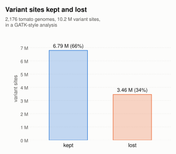
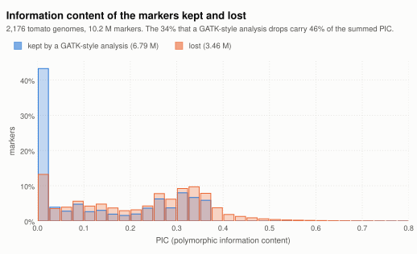

# Overlapping variants

When two variants overlap, such as a SNP inside a deletion, a VCF can write them in one record
or in separate records. Callers differ in which way they use, and population-genetics tools read
them differently; separate records can distort the results.

Let's imagine a reference `ATT` at positions 1 to 3 of `chrom1`, and three individuals:

| Individual | Haplotypes |
|---|---|
| ind1 | `A` / `A`: both copies carry a deletion of `TT` |
| ind2 | `ACT` / `ACT`: both copies carry a SNP, `T` to `C` at position 2 |
| ind3 | `A` / `ACT`: one copy of each |

Written **as one record**, whose alleles are the whole haplotypes, like freebayes and pvc do:

```
#CHROM  POS  REF  ALT     ind1  ind2  ind3
chrom1  1    ATT  A,ACT   1/1   2/2   1/2
```

Written **as separate records**, one per event, each at its own position, like GATK
HaplotypeCaller does. The SNP at position 2 lies inside the deletion, so its record needs the `*`
allele, which means "this position is deleted on this copy by a deletion that starts upstream":

```
#CHROM  POS  REF  ALT   ind1  ind2  ind3
chrom1  1    ATT  A     1/1   0/0   0/1
chrom1  2    T    C,*   2/2   1/1   1/2
```

Written **as separate records, without `*`**, like DeepVariant does. It calls each sample on its
own, and its cohorts are usually merged with GLnexus. GLnexus writes a copy that
carries the deletion as missing, `.`, in the SNP's record, and gives the reason in the FORMAT
field `RNC` as `-`, "unrepresentable overlapping deletion":

```
#CHROM  POS  REF  ALT   ind1  ind2  ind3
chrom1  1    ATT  A     1/1   0/0   0/1
chrom1  2    T    C     ./.   1/1   ./1
```

A single sample's VCF from DeepVariant, not merged, writes that copy as reference instead: ind3
would be `0/1` at position 2.

The first two forms say the same thing. The third has already lost information, the same way a
tool loses it when it reads the second form: as if `*` were read as missing in a merged cohort,
and as if `*` were recoded as reference in a single sample's VCF.

## How population-genetics tools handle `*`

Most population-genetics tools do not understand `*`. They usually handle it in one of three
ways, and each one distorts the results.

**`*` read as missing.** At position 2, ind1 becomes `./.` and ind3 becomes half or wholly
missing.

- The data go missing *because* an individual carries the deletion. Missing-data filters then
  remove sites or individuals in a biased way.
- Among the copies left, `C` has frequency 1, so the site looks fixed, although `C` is on only
  half of the copies.
- ind3, a true heterozygote at this locus, is lost.

**`*` recoded as the reference allele.** ind1 becomes `T/T` and ind3 `T/C` at position 2. This
invents an allele, `T`, that no copy in the sample carries, and counts the deletion a second
time, as a SNP.

**`*` counted as another allele.**

- If `C` and `*` are both taken as "not reference", every individual becomes `1/1`. ind3, a
  heterozygote, becomes a false homozygote.
- If the site is kept with three alleles, the deletion is counted twice: once at position 1 and
  again as `*` at position 2, and once more for every other variable position it covers. That
  adds segregating sites in perfect linkage disequilibrium.

The common workaround, keeping only biallelic SNPs and dropping SNPs close to indels (for
example with `bcftools filter --SnpGap`), avoids these artifacts, but at a cost. It
systematically loses SNPs on deletion-carrying copies and under-samples diversity in exactly
those regions. And it throws away the sites with more than two alleles, which are the most
informative ones, because a site with more alleles tells more individuals apart.

## The data lost

We applied the workaround to a VCF pvc wrote for 2,176 tomato genomes. First, records that hold
several SNPs were split into single SNPs, as `bcftools norm -a` does. Then only the biallelic SNPs
with no indel or STR within 10 bases were kept. Of 10.2 million variant sites, 3.5 million (34%)
were lost:

- 1.7 million indels and STRs;
- 1.3 million SNPs with more than two alleles;
- 0.5 million biallelic SNPs within 10 bases of an indel or STR.



Moreover, the lost markers are the more informative ones: they have a mean PIC of 0.22, the kept
ones 0.13, and the 34% of the markers that are lost carry 46% of the summed PIC.



*The share of the kept and of the lost markers in each range of PIC.*

Of the kept markers, 42% are nearly invariant, with a PIC under 0.02, against 13% of the lost
ones. Only the lost markers go above 0.375, because only a site with more than two alleles can.
