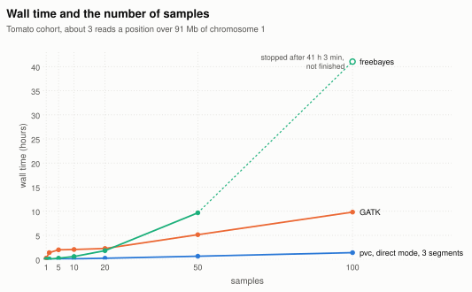
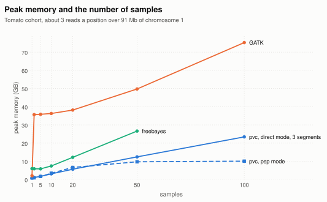
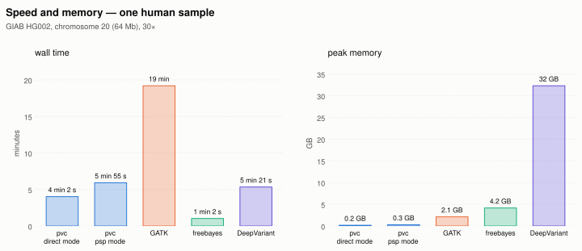

# Performance

pvc's run time and memory have been compared with those of other tools on:

- a tomato cohort, from 1 sample to 100;
- one human sample, GIAB's HG002, from 5× to about 60×.

The tools used in the comparison were:

- pvc version 909ea135
- GATK 4.6.0.0, HaplotypeCaller and joint genotyping;
- freebayes 1.3.6;
- DeepVariant 1.10.0, on the human sample only.

pvc was run in both of its modes (see [Calling](calling.md)):

- **direct mode**: `call-from-alignments`, one command from the alignments to the VCF, with the
  built-in parameter values;
- **psp mode**: `generate-psps` for each sample, then `estimate-parameters`, then
  `call-from-psps`. Its times include all three steps.

## How it was measured

Everything ran on one Linux server (Intel Xeon E5-2667 v4, 32 cores), limited to 30 cores and
80 GB of memory, with no other work running.

Each tool was given the 30 cores and run as its documentation recommends:

- **pvc, direct mode**: one command with `--threads 30`. It was also run with the regions cut
  into 3 equal segments, one command each with 10 threads, all three at once, and their VCFs
  joined: the way GATK and freebayes are usually spread over a machine.
- **pvc, psp mode**: one `generate-psps` per sample, up to 30 at once; then one
  `estimate-parameters` and one `call-from-psps`, each with `--threads 30`.
- **GATK**: with one sample, HaplotypeCaller straight to a VCF. With more, one GVCF per sample,
  then GenomicsDBImport and GenotypeGVCFs, each step run as 30 processes at once, each over its
  own piece of the regions.
- **freebayes**: it has no threads, so the regions were cut into blocks, 30 run at once, and the
  VCFs joined.
- **DeepVariant**: `--num_shards 30`.

The numbers are reported are:

- **wall time**: the time from start to finish;
- **memory**: the largest total memory of the processes running at once;
- **CPU time**: the time all the cores together spent working. CPU time divided by wall time is
  how many cores were busy, on average.

The input files were read once before each run, so the disk cache was used.

## A tomato cohort, 1 to 100 samples

Tomato accessions over 91 Mb of chromosome 1 (SL4.0).

*Wall time from 1 to 100 samples, with pvc in direct mode split into 3 segments.*

*Peak memory from 1 to 100 samples. freebayes's line stops at 50 samples, because its run with 100 did not finish and
recorded no memory.*

Wall time / memory:

| samples | pvc, direct mode | pvc, direct mode, 3 segments | pvc, psp mode | GATK | freebayes | floor: reading only |
|---|---|---|---|---|---|---|
| 1 | 1 min 53 s / 0.3 GB | 43 s / 0.6 GB | 3 min 58 s / 0.5 GB | 16 min / 2.1 GB | 1 min 42 s / 6.0 GB | 2.6 s |
| 2 | 6 min 35 s / 0.5 GB | 2 min 23 s / 1.1 GB | 10 min / 0.8 GB | 1 h 25 min / 36 GB | 5 min 34 s / 5.9 GB | 7.3 s |
| 5 | 13 min / 0.8 GB | 5 min 12 s / 1.7 GB | 7 min 59 s / 1.7 GB | 2 h / 36 GB | 16 min / 5.8 GB | 14 s |
| 10 | 20 min / 1.4 GB | 8 min 16 s / 3.1 GB | 11 min / 3.4 GB | 2 h 4 min / 36 GB | 37 min / 7.4 GB | 22 s |
| 20 | 39 min / 2.7 GB | 15 min / 5.6 GB | 19 min / 6.6 GB | 2 h 16 min / 38 GB | 1 h 50 min / 12 GB | 27 s |
| 50 | 1 h 25 min / 5.4 GB | 40 min / 12 GB | 1 h 9 min / 9.7 GB | 5 h 8 min / 50 GB | 9 h 41 min / 27 GB | 1 min 1 s |
| 100 | 3 h 5 min / 10 GB | 1 h 25 min / 23 GB | 1 h 37 min / 10 GB | 9 h 50 min / 75 GB | stopped after 41 h | 1 min 40 s |

- **With 100 samples, pvc takes 1 h 25 min to 3 h 5 min, depending on how it is run; GATK takes
  9 h 50 min.** freebayes did not finish: after 41 hours, 6 of its 114 blocks had spent 24 to 36
  hours each on a single site, and the run was stopped.
- **With 100 samples, psp mode is about as fast as direct mode in 3 segments, with less than half
  its memory:** 1 h 37 min and 10 GB, against 1 h 25 min and 23 GB. GATK used 75 GB.
- **Direct mode in one command uses few of its 30 cores.** With 100 samples it keeps about 7
  busy on average, and with one sample about 1.4. Cut into 3 segments run at once, it finishes
  with 100 samples in less than half the time, 1 h 25 min against 3 h 5 min, but each segment
  needs its own memory, so the total more than doubles, from 10 GB to 23 GB.
- **GATK's memory jumps from 2 GB with one sample to 36 GB with two.** With one sample it writes
  the VCF directly; with more it runs its joint genotyping, as 30 Java processes at once.

CPU time, with the average number of busy cores in brackets:

| samples | pvc, direct mode | pvc, direct mode, 3 segments | pvc, psp mode | GATK | freebayes |
|---|---|---|---|---|---|
| 1 | 2 min 42 s (1.4) | 2 min 40 s (3.7) | 17 min (4.4) | 3 h 44 min (13.8) | 22 min (12.8) |
| 100 | 22 h 45 min (7.4) | 15 h 56 min (11.3) | 29 h 13 min (18.1) | 187 h (19.0) | did not finish |

With 100 samples GATK uses about 6 to 12 times as much CPU time as pvc.

### pvc's three steps in psp mode

pvc called the whole tomato collection, 2,176 genomes of 783 Mb each, in psp mode on one server
(Intel Xeon 6527P, 96 cores):

| step | wall time | run as |
|---|---|---|
| 1. `generate-psps` | 80 h | one per sample, up to 16 at once |
| 2. `estimate-parameters` | 34 h | 16 threads |
| 3. `call-from-psps` | 104 h | 48 threads |
| all three | 218 h, about 9 days | |

No step used more than 33 GB of memory.

- **One sample's psp file took 19 minutes** (the median); 9 in 10 took under 48 minutes, and the
  longest 8 h 22 min. Each `generate-psps` used 0.5 GB (the median); the largest 8.3 GB.
- **Calling was the longest step,** 104 hours.

**Adding a sample to this cohort** costs one psp file, about 20 minutes, then estimating the
parameters and calling again over all the samples: about 138 hours. The psp files of the samples
already in the cohort, 80 hours of work, are not written again. In direct mode the whole cohort
would be called again from the alignments.

## One human sample, HG002 chromosome 20

GIAB's HG002 over the whole of chromosome 20 (64 Mb), with its reads drawn down to 5×, 10× and
30×, and at their full depth of about 60×.

*Wall time and peak memory at 30×.*

Wall time / memory:

| depth | pvc, direct mode | pvc, psp mode | GATK | freebayes | DeepVariant | floor: reading only |
|---|---|---|---|---|---|---|
| 5× | 59 s / 0.2 GB | 2 min 46 s / 0.3 GB | 8 min 2 s / 1.1 GB | 15 s / 4.1 GB | 5 min 5 s / 32 GB | 0.2 s |
| 10× | 1 min 29 s / 0.2 GB | 3 min 17 s / 0.3 GB | 11 min / 1.4 GB | 24 s / 4.2 GB | 4 min 42 s / 32 GB | 0.5 s |
| 30× | 4 min 2 s / 0.2 GB | 5 min 55 s / 0.3 GB | 19 min / 2.1 GB | 1 min 2 s / 4.2 GB | 5 min 21 s / 32 GB | 1.5 s |
| ~60× | 9 min 12 s / 0.2 GB | 11 min / 0.3 GB | 30 min / 1.6 GB | 1 min 50 s / 4.1 GB | 6 min 45 s / 32 GB | 3.1 s |

- **freebayes is the fastest on one sample, 4 to 5 times as fast as pvc in direct mode.** It
  keeps about 20 cores busy, where pvc's direct mode keeps 1.
- **pvc uses the least memory, 0.2 to 0.3 GB,** against 1 to 2 GB for GATK, 4 GB for freebayes
  and 32 GB for DeepVariant.
- **pvc's direct mode uses a single core on one sample.** At 30× it spends 4 min 10 s of CPU
  time in 4 min 2 s. Its time therefore grows with depth: 59 s at 5×, 9 min 12 s at about 60×.
- **pvc's psp mode is slower than direct mode on one sample.** It writes the psp file before
  calling, and it estimates the parameters, which takes 34 to 42 s at every depth.

CPU time at 30×, with the average number of busy cores in brackets:

| pvc, direct mode | pvc, psp mode | GATK | freebayes | DeepVariant |
|---|---|---|---|---|
| 4 min 10 s (1.0) | 14 min 41 s (2.5) | 4 h 26 min (13.8) | 21 min (20.6) | 2 h 25 min (27.1) |
